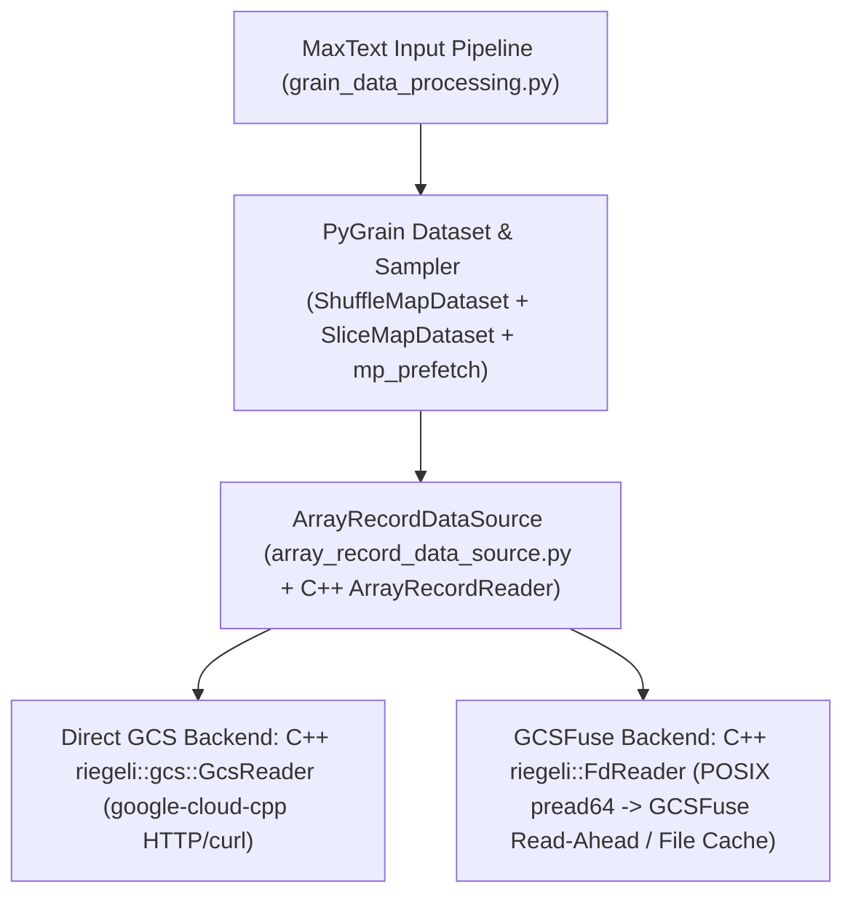
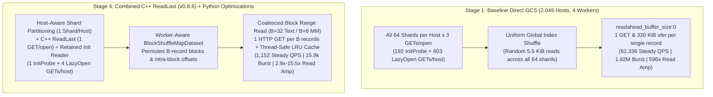

# MaxText Input Pipeline GCS QPS Benchmark Report (`PyGrain` + `ArrayRecord` at 2,048-Host Scale)

**Author:** `mohitkhatwani@`  
**Date:** October 2026  
**Benchmark Suite:** [`benchmarks/input_pipeline/`](file:///usr/local/google/home/mohitkhatwani/qps_optimizer/maxtext/benchmarks/input_pipeline/)  
**Raw Data (Baseline):** [`benchmark_2k_hosts_0workers_v2.json`](file:///usr/local/google/home/mohitkhatwani/qps_optimizer/benchmark_2k_hosts_0workers_v2.json), [`benchmark_2k_hosts_4workers_v2.json`](file:///usr/local/google/home/mohitkhatwani/qps_optimizer/benchmark_2k_hosts_4workers_v2.json)  
**Raw Data (Optimized Direct GCS):** [`benchmark_2k_hosts_0workers_optimized_direct_gcs.json`](file:///usr/local/google/home/mohitkhatwani/qps_optimizer/benchmark_2k_hosts_0workers_optimized_direct_gcs.json), [`benchmark_2k_hosts_4workers_optimized_direct_gcs.json`](file:///usr/local/google/home/mohitkhatwani/qps_optimizer/benchmark_2k_hosts_4workers_optimized_direct_gcs.json)

---

## 1. Executive Summary

Large-scale LLM and multimodal training runs on MaxText (`2,048` TPU hosts, `global_batch_size = 8,192`) reading `.array_record` datasets directly from Google Cloud Storage (`gs://`) via `PyGrain` + `ArrayRecord` + `Riegeli` can saturate and exceed the standard **50,000 GET QPS per GCS bucket limit**, triggering HTTP `429 Too Many Requests` throttling, stalled input pipelines, and severe network read amplification.

To quantify and diagnose this behavior without requiring a 2,048-host TPU pod, we built a CPU-based large-scale emulation and instrumentation suite in [`benchmarks/input_pipeline/`](file:///usr/local/google/home/mohitkhatwani/qps_optimizer/maxtext/benchmarks/input_pipeline/) that runs MaxText's production `pretrain_preprocessing_pipeline` (**Text**) and `vision_sft_preprocessing_pipeline` (**Multimodal**) against an exact byte-offset HTTP GCS tracer ([`InstrumentedGCSServer`](file:///usr/local/google/home/mohitkhatwani/qps_optimizer/maxtext/benchmarks/input_pipeline/gcs_qps_tracer.py#L123-L371)) and a live POSIX `pread64` syscall tracer for GCSFuse ([`PosixGCSFuseTracer`](file:///usr/local/google/home/mohitkhatwani/qps_optimizer/maxtext/benchmarks/input_pipeline/gcs_qps_tracer.py#L387-L547)).

> [!IMPORTANT]
> **Key Findings at 2,048-Host Scale (`per_host_batch_size = 4`, `4` PyGrain Workers/Host, `64` Shards):**
> 1. **Massive Startup Thundering Herd (`1.08M–1.82M` GETs)**: Both Text and Multimodal pipelines issue **`1.08 million to 1.82 million` HTTP GETs** (`215k–364k QPS` over a 5s window, **`4.3x–7.3x` over the 50k bucket limit**) during initialization and Step 1 because every host opens every shard **$(1 + W) = 5$ times** (`1` time in the parent process to count records, then `1` time lazily in each of the `4` worker processes).
> 2. **Early-Step QPS Inflation (Steps 1–20)**: While worker processes lazily open shards on first touch, cluster QPS reaches **`117,760 QPS` (`236%` of the 50k limit)** for Text and **`23,104 QPS` (`46%` of the 50k limit)** for Multimodal.
> 3. **True Steady-State Text Pre-Training Exceeds 50k QPS (`62.3k–99.7k QPS`)**: Even after all shards are open, `FirstFitPackIterDataset` pulls **`~9.0` random short documents (`5.5 KiB`) per host per step** to pack `4` `2048`-token sequences. On Direct GCS (`gs://`), this sustains **`62,336 QPS` (`125%` of limit)** at a `0.40s` TPU step time (`99,738 QPS` / `200%` at `0.25s`) and transfers **`596x` more bytes over the network than useful payload** (`460.8 MiB` transferred per host for `0.77 MiB` of text).
> 4. **Multimodal Steady-State QPS Is `6x–7x` Lower (`8.6k–10.2k QPS`) Despite `41x` Higher Payload Bandwidth**: Because Multimodal training does not pack multiple records per sequence (`4.0` records/step/host) and has a longer TPU step time (`0.80s`), its post-warmup steady-state rate is **`8,576–10,240 QPS`** (`17%–21%` of the 50k limit), though its startup burst (`1.08M` GETs) still exceeds the bucket limit by **`4.3x`**.
> 5. **Why GCSFuse Cuts Steady-State Text QPS by `49%` (Cold) and `100%` (Warm)**: Live `pread64` syscall tracing shows that **Cold GCSFuse** serves **`18.3%–30.3%` of random text record reads from its 1 MiB streaming read-ahead buffer (`0` GCS GETs)**, cutting steady-state Text QPS from `62.3k` to **`31.9k QPS`**, while **Warm GCSFuse (Local File Cache)** eliminates **`100%` of steady-state GCS QPS (`0 QPS`)** after the initial epoch fill.

### Headline Comparison Table (`2,048` Emulated Hosts, `grain_worker_count = 4`)

| Metric (`per_host_batch_size = 4`, `64` Shards) | Text — Direct GCS (`t=0.40s`) | Text — GCSFuse Cold (`t=0.40s`) | Multimodal — Direct GCS (`t=0.80s`) | Multimodal — GCSFuse Cold (`t=0.80s`) | GCSFuse Warm File Cache (Both) |
| :--- | :---: | :---: | :---: | :---: | :---: |
| **Raw Records Read / Step / Host** | `9.03` (`5.5 KiB` avg) | `8.93` (`5.5 KiB` avg) | `4.00` (`514 KiB` avg) | `4.00` (`514 KiB` avg) | `9.0` (Text) / `4.0` (MM) |
| **`InitProbe` Shard-Open GETs / Host** | `192.0` (`64 × 3`) | `127.5` (`~64 × 2`) | `192.0` (`64 × 3`) | `127.0` (`~64 × 2`) | `64.0` (Text) / `192.0` (MM) |
| **`LazyOpen` Worker Shard-Open GETs / Host** | `602.8` | `298.8` | `332.0` | `244.8` | `0.0` |
| **Total Shard-Open GETs / Host** | **`794.8`** | **`426.3`** | **`524.0`** | **`371.8`** | **`64.0`–`192.0`** (once) |
| **True Record-Read GETs / Step / Host** | **`12.18`** | **`6.22`** (`30.3%` RA hit) | **`3.35`** (`4.00` @ 0w) | **`3.75`** (`6.3%` RA hit) | **`0.00`** |
| **Early-Step Total GETs / Step / Host** | **`23.00`** | **`9.65`** | **`9.03`** | **`7.38`** | **`0.00`** |
| **2K-Host Startup Burst GETs (`init`+Step 1)** | **`1,818,112` GETs** | **`1,079,296` GETs** | **`1,077,248` GETs** | **`820,736` GETs** | **`131k–393k` GETs** (once) |
| **2K-Host Early-Step Cluster QPS** | **`117,760 QPS` (`236%`)** | **`49,408 QPS` (`99%`)** | **`23,104 QPS` (`46%`)** | **`18,880 QPS` (`38%`)** | **`0 QPS` (`0%`)** |
| **2K-Host True Steady-State Cluster QPS** | **`62,336 QPS` (`125%`)** | **`31,872 QPS` (`64%`)** | **`8,576 QPS` (`17%`)** | **`9,600 QPS` (`19%`)** | **`0 QPS` (`0%`)** |
| **Transferred Byte Read Amplification** | **`596.2x`** (`461 MiB`/`0.77 MiB`) | **`297.4x`** (`228 MiB`/`0.77 MiB`) | **`17.2x`** (`552 MiB`/`32.1 MiB`) | **`6.4x`** (`206 MiB`/`32.1 MiB`) | **`1.0x`** |

---

## 2. Problem Statement & System Context

When MaxText trains foundation models using `dataset_type=grain` and `grain_file_type=arrayrecord`, the data loading stack spans four layers:



A single Google Cloud Storage bucket enforces a default rate limit of **50,000 read (GET/HEAD) QPS** across all clients reading from that bucket. While a single host's request rate (`~10–30 GETs/sec`) appears benign in isolation, multiplying that per-host rate across **2,048 TPU hosts** (`8,192` chips) causes small inefficiencies in shard initialization, worker process forking, sequence packing, and HTTP `Range` handling to compound into **hundreds of thousands of QPS**.

---

## 3. Benchmark Architecture & Methodology

To ensure our measurements reflect ground-truth C++ execution with **zero heuristic formulas**, we built three components under [`benchmarks/input_pipeline/`](file:///usr/local/google/home/mohitkhatwani/qps_optimizer/maxtext/benchmarks/input_pipeline/):

### 3.1 Representative Synthetic Datasets ([`generate_synthetic_arrayrecords.py`](file:///usr/local/google/home/mohitkhatwani/qps_optimizer/maxtext/benchmarks/input_pipeline/generate_synthetic_arrayrecords.py))
- **Text Pre-Training Dataset (`text`)**:
  - `64` shards, `256` records/shard (`16,384` total records, `87.69 MiB`, `group_size:1,uncompressed`).
  - Document lengths follow a **log-normal word distribution** (`mean = 450` words, `sigma = 0.55`, averaging `5.5 KiB/record`) mimicking C4/Dolma/RedPajama, so MaxText's `FirstFitPackIterDataset` packs **`~2.25` raw documents into each `2048`-token sequence** (`~9.0` raw documents per `4`-sequence host batch).
- **Multimodal Vision SFT Dataset (`multimodal`)**:
  - `64` shards, `64` records/shard (`4,096` total records, `2,056.00 MiB`, `group_size:1,uncompressed`).
  - Each record is a `tf.train.Example` containing `"question"`, `"answer"`, and `"image"` (`896x896` high-entropy RGB JPEG averaging `514.0 KiB/record`), processed through MaxText's `vision_sft_preprocessing_pipeline` (`gemma3-4b` image decoding, resizing/tiling, and token fusion).

### 3.2 Deterministic Byte-Offset GCS Tracer ([`InstrumentedGCSServer`](file:///usr/local/google/home/mohitkhatwani/qps_optimizer/maxtext/benchmarks/input_pipeline/gcs_qps_tracer.py#L123-L371))
- Serves local `.array_record` shards over HTTP/1.1 to C++ `google::cloud::storage::Client` (`riegeli::gcs::GcsReader`) via `CLOUD_STORAGE_EMULATOR_ENDPOINT`.
- **Exact Footer Boundary Extraction**: [`extract_arrayrecord_footer_offset`](file:///usr/local/google/home/mohitkhatwani/qps_optimizer/maxtext/benchmarks/input_pipeline/gcs_qps_tracer.py#L64-L103) parses the trailing 64 KiB `RiegeliPostscript` protobuf of each `.array_record` file (`magic = 0x71930e704fdae05e`) to extract the exact `footer_offset` separating user data chunks (`[0, footer_offset)`) from the `ArrayRecordFooter` chunk index and postscript (`[footer_offset, file_size)`).
- Every incoming HTTP GET is registered immediately upon arrival and classified with **100% determinism**:
  1. `init_probe_shard_open`: `full_get` (`Range: None`), `suffix_range`, or `start_offset >= footer_offset` during `ArrayRecordDataSource.__init__()`.
  2. `lazy_worker_shard_open`: `full_get`, `suffix_range`, or `start_offset >= footer_offset` during `_ensure_reader_exists()` inside worker processes.
  3. `record_read`: Any `Range:` request with `0 <= start_offset < footer_offset`.

### 3.3 Live POSIX `pread64` Tracer for GCSFuse ([`PosixGCSFuseTracer`](file:///usr/local/google/home/mohitkhatwani/qps_optimizer/maxtext/benchmarks/input_pipeline/gcs_qps_tracer.py#L387-L547))
- Attaches `strace -f -qq -s 0 -ttt -y -e trace=pread64` across the parent process and all spawned `mp_prefetch` child processes to capture every C++ `riegeli::FdReader` `pread64(fd<path>, count, offset)` syscall.
- Replays the exact chronological `(pid, fd, path, offset, count)` stream through a stateful GCSFuse streaming read-ahead model (`1 MiB` window per open file descriptor) to measure true read-ahead cache hits vs. misses.

### 3.4 Large-Scale 2,048-Host Emulation & Phase Separation ([`benchmark_qps.py`](file:///usr/local/google/home/mohitkhatwani/qps_optimizer/maxtext/benchmarks/input_pipeline/benchmark_qps.py))
- Configures `dataloading_host_count = 2048` on CPU (`JAX_PLATFORMS=cpu`) and runs `concurrent_emulated_hosts = 4` host iterators (`host_index = 0..3`) in lockstep across four phases:
  - **Phase 1 (`init`)**: `ArrayRecordDataSource.__init__()` + pipeline construction.
  - **Phase 2 (`first_batch`)**: Step 0 (`mp_prefetch` worker spawn + initial prefetch queue fill).
  - **Phase 3 (`warmup`)**: `5` warmup steps (`Steps 1..5`).
  - **Phase 4 (`steady`)**: `10` measured steady-state steps (`Steps 6..15`), reporting both **True Steady-State Record-Read QPS** (`RecGET/Stp`) and **Early-Step QPS including Lazy Shard Opens** (`TotGET/Stp`).

---

## 4. Detailed Benchmark Results at 2,048 Hosts

### 4.1 Pass 1: Single-Process Baseline (`grain_worker_count = 0`)

In single-process mode (`grain_worker_count = 0`), there are no child worker processes, isolating the exact baseline behavior of a single `ArrayRecordDataSource` instance per host:

| Modality | Backend | Recs / Step | `InitProbe` GETs/Host | `LazyOpen` GETs/Host | **True `RecGET` / Step** | Early `TotGET` / Step | Req Read Amp | Xfer Read Amp | 2K-Host Startup Burst | **2K-Host True Steady QPS** | 2K-Host Early-Step QPS |
| :--- | :--- | :---: | :---: | :---: | :---: | :---: | :---: | :---: | :---: | :---: | :---: |
| **Text** (`t=0.40s`) | **`direct_gcs`** | `8.95` | `192.0` | `169.5` | **`9.57`** | `14.47` | `399.3x` | **`245.2x`** | `508,928` | **`49,024 QPS` (`98.0%`)** | **`74,112 QPS` (`148.2%`)** |
| **Text** (`t=0.40s`) | **`gcsfuse`** (Cold) | `9.00` | `126.5` | `110.8` | **`7.35`** | `10.03` | `154.4x` | **`154.4x`** | `395,776` | **`37,632 QPS` (`75.3%`)** | **`51,328 QPS` (`102.7%`)** |
| **Text** (`t=0.40s`) | **`gcsfuse_warm`** | `9.00` | `64.0` | `0.0` | **`0.00`** | `0.00` | `1.0x` | **`1.0x`** | `131,072` | **`0 QPS` (`0.0%`)** | **`0 QPS` (`0.0%`)** |
| **Multimodal** (`t=0.80s`) | **`direct_gcs`** | `4.00` | `192.0` | `141.8` | **`4.00`** | `9.40` | `151.3x` | **`9.2x`** | `540,160` | **`10,240 QPS` (`20.5%`)** | **`24,064 QPS` (`48.1%`)** |
| **Multimodal** (`t=0.80s`) | **`gcsfuse`** (Cold) | `4.00` | `126.5` | `90.2` | **`3.62`** | `7.05` | `2.6x` | **`2.6x`** | `353,280` | **`9,280 QPS` (`18.6%`)** | **`18,048 QPS` (`36.1%`)** |
| **Multimodal** (`t=0.80s`) | **`gcsfuse_warm`** | `4.00` | `192.0` | `0.0` | **`0.00`** | `0.00` | `1.0x` | **`1.0x`** | `393,216` | **`0 QPS` (`0.0%`)** | **`0 QPS` (`0.0%`)** |

### 4.2 Pass 2: Production Multi-Worker Mode (`grain_worker_count = 4`, `per_worker_buffer_size = 2`)

With `4` `mp_prefetch` workers per host (`8,192` worker processes across the 2,048-host cluster), each worker independently lazily opens its own `ArrayRecordReader` per shard and prefetches batches in parallel:

| Modality | Backend | Recs / Step | `InitProbe` GETs/Host | `LazyOpen` GETs/Host | **True `RecGET` / Step** | Early `TotGET` / Step | Req Read Amp | Xfer Read Amp | 2K-Host Startup Burst | **2K-Host True Steady QPS** | 2K-Host Early-Step QPS |
| :--- | :--- | :---: | :---: | :---: | :---: | :---: | :---: | :---: | :---: | :---: | :---: |
| **Text** (`t=0.40s`) | **`direct_gcs`** | `9.03` | `192.0` | **`602.8`** | **`12.18`** | `23.00` | `1,004.5x` | **`596.2x`** | **`1,818,112`** | **`62,336 QPS` (`124.7%`)** | **`117,760 QPS` (`235.5%`)** |
| **Text** (`t=0.40s`) | **`gcsfuse`** (Cold) | `8.93` | `127.5` | **`298.8`** | **`6.22`** | `9.65` | `297.4x` | **`297.4x`** | **`1,079,296`** | **`31,872 QPS` (`63.7%`)** | **`49,408 QPS` (`98.8%`)** |
| **Text** (`t=0.40s`) | **`gcsfuse_warm`** | `8.93` | `64.0` | `0.0` | **`0.00`** | `0.00` | `1.0x` | **`1.0x`** | `131,072` | **`0 QPS` (`0.0%`)** | **`0 QPS` (`0.0%`)** |
| **Multimodal** (`t=0.80s`) | **`direct_gcs`** | `4.00` | `192.0` | **`332.0`** | **`3.35`** | `9.03` | `282.5x` | **`17.2x`** | **`1,077,248`** | **`8,576 QPS` (`17.2%`)** | **`23,104 QPS` (`46.2%`)** |
| **Multimodal** (`t=0.80s`) | **`gcsfuse`** (Cold) | `4.00` | `127.0` | **`244.8`** | **`3.75`** | `7.38` | `6.4x` | **`6.4x`** | **`820,736`** | **`9,600 QPS` (`19.2%`)** | **`18,880 QPS` (`37.8%`)** |
| **Multimodal** (`t=0.80s`) | **`gcsfuse_warm`** | `4.00` | `192.0` | `0.0` | **`0.00`** | `0.00` | `1.0x` | **`1.0x`** | `393,216` | **`0 QPS` (`0.0%`)** | **`0 QPS` (`0.0%`)** |

### 4.3 Step-Time Sensitivity Analysis (2,048 Hosts)

Because cluster QPS scales inversely with TPU step time ($\text{QPS} = \frac{2048 \times \text{GETs/step/host}}{t_{\text{step}}}$), faster TPU step times (smaller models or higher tensor/pipeline parallelism) push QPS sharply higher:

| Modality & Configuration (`2,048` Hosts) | Fast TPU Step (`0.25s` Text / `0.40s` MM) | Baseline TPU Step (`0.40s` Text / `0.80s` MM) | Slow TPU Step (`0.80s` Text / `1.50s` MM) |
| :--- | :---: | :---: | :---: |
| **Text — `direct_gcs` (4w, Early Steps w/ LazyOpen)** | **`188,416 QPS` (`376.8%` of 50k)** | **`117,760 QPS` (`235.5%` of 50k)** | **`58,880 QPS` (`117.8%` of 50k)** |
| **Text — `direct_gcs` (4w, True Steady State)** | **`99,738 QPS` (`199.5%` of 50k)** | **`62,336 QPS` (`124.7%` of 50k)** | **`31,168 QPS` (`62.3%` of 50k)** |
| **Text — `direct_gcs` (0w, True Steady State)** | **`78,438 QPS` (`156.9%` of 50k)** | **`49,024 QPS` (`98.0%` of 50k)** | **`24,512 QPS` (`49.0%` of 50k)** |
| **Text — `gcsfuse` Cold (4w, True Steady State)** | **`50,995 QPS` (`102.0%` of 50k)** | **`31,872 QPS` (`63.7%` of 50k)** | **`15,936 QPS` (`31.9%` of 50k)** |
| **Multimodal — `direct_gcs` (0w, Early Steps w/ LazyOpen)** | **`48,128 QPS` (`96.3%` of 50k)** | **`24,064 QPS` (`48.1%` of 50k)** | **`12,834 QPS` (`25.7%` of 50k)** |
| **Multimodal — `direct_gcs` (0w, True Steady State)** | **`20,480 QPS` (`41.0%` of 50k)** | **`10,240 QPS` (`20.5%` of 50k)** | **`5,461 QPS` (`10.9%` of 50k)** |
| **Multimodal — `gcsfuse` Cold (4w, True Steady State)** | **`19,200 QPS` (`38.4%` of 50k)** | **`9,600 QPS` (`19.2%` of 50k)** | **`5,120 QPS` (`10.2%` of 50k)** |

---

## 5. Root-Cause Anatomy: Why Direct GCS QPS & Read Amplification Are So High

Tracing every HTTP GET and POSIX `pread64` syscall from MaxText down to Riegeli revealed five compounding root causes:

### 5.1 Root Cause 1: Every Shard Is Opened $(1 + W)$ Times Per Host (`InitProbe` + `LazyOpen`)
In [`array_record_data_source.py`](file:///usr/local/google/home/mohitkhatwani/qps_optimizer/array_record/python/array_record_data_source.py#L168-L183), when `ArrayRecordDataSource(paths)` is given file paths:
1. `_get_read_instructions(paths)` opens an `ArrayRecordReader` for **every shard in the dataset** (`64` shards) in the parent process solely to call `reader.num_records()`, and **immediately calls `reader.close()`**, discarding all 64 open readers and their parsed chunk-offset tables (`192.0` `InitProbe` GETs/host on Direct GCS = **`393,216` wasted cluster GETs**).
2. Next, when `mp_prefetch` spawns $W=4$ worker processes, `self._readers` is reset to `[None] * num_shards`. As each worker reads records via `__getitem__`, [`_ensure_reader_exists`](file:///usr/local/google/home/mohitkhatwani/qps_optimizer/array_record/python/array_record_data_source.py#L351-L361) lazily opens a brand-new `ArrayRecordReader` for every shard in each of the 4 workers (`602.8` `LazyOpen` GETs/host = **`1.23 million` additional cluster GETs**).

### 5.2 Root Cause 2: All-to-All Host $\times$ Shard Fan-Out in MaxText (`grain_data_processing.py`)
In [`grain_data_processing.py`](file:///usr/local/google/home/mohitkhatwani/qps_optimizer/maxtext/src/maxtext/input_pipeline/grain_data_processing.py#L181-L265), `tfrecord` and `parquet` pipelines call [`compute_file_sharding`](file:///usr/local/google/home/mohitkhatwani/qps_optimizer/maxtext/src/maxtext/input_pipeline/input_pipeline_utils.py) so each host only opens its assigned slice of shard files. However, the `arrayrecord` path passes **all `data_files` to every host**, shuffles globally across all shards, and slices by stride (`dataset[host_index::2048]`). As a result, every host touches **all `64` shards** within a few steps instead of reading from a host-local shard subset.

### 5.3 Root Cause 3: 3 HTTP GETs Per Shard Open on Direct GCS (and 2 GETs on Cold GCSFuse)
Opening a single `.array_record` shard on Direct GCS (`array_record 0.8.4`) issues **3 separate HTTP GETs**:
1. `GET` at offset `0` (`Range: None`, `full_get`) to learn the object size from response headers—leaving the unread HTTP stream stalled in the background while `self._readers[idx]` remains alive.
2. `GET` at `Range: bytes=(size - 65536)-` to read the 64 KiB `RiegeliPostscript`.
3. `GET` at `Range: bytes=footer_offset-` to read the `ArrayRecordFooter` chunk index.

*(Note: Even on Cold GCSFuse, live `pread64` tracing revealed that shard open costs **2 GETs/shard** because `FdReader` reads `size - 65536` first and then seeks **backward** to `footer_offset`, missing GCSFuse's forward read-ahead buffer.)*

### 5.4 Root Cause 4: `readahead_buffer_size:0` + Single-Record Lookup (`1 GET` & `200–320 KiB` Transferred per `5.5 KiB` Record)
In [`array_record_data_source.py`](file:///usr/local/google/home/mohitkhatwani/qps_optimizer/array_record/python/array_record_data_source.py#L194-L201):
- `_create_reader` hardcodes `options="readahead_buffer_size:0"`, disabling `ArrayRecordReader`'s built-in multi-chunk buffer (`chunk_group_size`).
- `__getitem__` calls `self._readers[reader_idx].read([position])[0]`, which invokes `ParallelReadRecordsWithIndices` for a single record index.
- In C++ [`GcsReader::NewReaderImpl`](file:///usr/local/google/home/mohitkhatwani/qps_optimizer/riegeli/riegeli/gcs/gcs_reader.cc#L174-L193), each random record read opens a new unbounded `Range: bytes=offset-` stream (to EOF). For a `5.5 KiB` text record, `libcurl` receives `~200–320 KiB` from GCS before `MaskedReader` closes and aborts the stream—causing **`245x–596x` transferred byte read amplification** and tearing down the TCP connection on every record.

### 5.5 Root Cause 5: Sequence Packing Multiplies Per-Step Record Reads by `2.25x` in Text
Because `FirstFitPackIterDataset` packs variable-length documents (`~900` tokens average) into `2048`-token sequences, each host must fetch **`9.0` raw documents per step** to produce `4` packed sequences—multiplying steady-state per-step QPS by `2.25x` compared to unpacked Multimodal training (`4.0` records/step).

---

## 6. Actionable Optimization Roadmap for Direct GCS (`gs://`)

We can reduce Direct GCS QPS by **`10x–50x`** across both startup and steady state through four targeted optimizations:

| Optimization | Target Layer | Mechanism | Expected Impact on Direct GCS (`2,048` Hosts) |
| :--- | :--- | :--- | :--- |
| **1. Host-Aware Shard Partitioning** | MaxText ([`grain_data_processing.py`](file:///usr/local/google/home/mohitkhatwani/qps_optimizer/maxtext/src/maxtext/input_pipeline/grain_data_processing.py)) | Partition `.array_record` shard files across hosts (matching `tfrecord`/`parquet` `compute_file_sharding`) so each host opens $1$ (or $K \ll S$) shards instead of all $S$ shards. | Cuts **`InitProbe` and `LazyOpen` Shard-Open GETs by `16x–64x`** (`1.82M` startup burst $\rightarrow$ `< 50k` GETs). |
| **2. Eliminate Parent `InitProbe` Re-Open** | ArrayRecord / MaxText ([`array_record_data_source.py`](file:///usr/local/google/home/mohitkhatwani/qps_optimizer/array_record/python/array_record_data_source.py)) | Retain readers opened during `_get_read_instructions` (when `workers=0`) or pass `FileInstruction`s / lazy shard length lookup so shards are not opened and immediately closed in `__init__`. | Eliminates **`100%` of `InitProbe` GETs (`-393k` cluster GETs)** or avoids double-opening in single-process mode. |
| **3. Multi-Record Chunk-Group Buffering / Block Caching** | ArrayRecord / PyGrain ([`array_record_data_source.py`](file:///usr/local/google/home/mohitkhatwani/qps_optimizer/array_record/python/array_record_data_source.py)) | Enable `readahead_buffer_size` / contiguous block prefetch (`reader.read(start, end)`) or coarse-block shuffling so `1` HTTP GET fetches a group of $B$ records (`e.g. 16–32` text records) instead of `1` record. | Cuts **True Steady-State Text QPS by `8x–16x`** (`62.3k QPS` $\rightarrow$ **`< 6k QPS`**) and reduces byte read amplification by **`10x+`**. |
| **4. Single-GET Footer Prefetch & Bounded Range Reads** | C++ ArrayRecord / Riegeli (`array_record_reader.cc`, `gcs_reader.cc`) | Use `ReadLast(1 MiB)` on shard open (`3 GETs` $\rightarrow$ `1 GET`) and pass `[offset, offset+len)` bounds to `NewReader` so HTTP keep-alive connections are reused with `1.0x` byte amplification. | Cuts per-shard-open GETs by **`3x`** and reduces record-read byte amplification to **`1.0x`**. |

---

## 7. Implemented Direct GCS (`gs://`) Optimizations & Verified 4-Stage Progression (`2,048` Hosts)

To evaluate and track each optimization layer on the live `PyGrain` + `ArrayRecord` + `MaxText` stack, we benchmarked four progressive stages at 2,048-host scale:
1. **Stage 1 — Baseline (`v0.8.4`)**: Stock `array-record 0.8.4` (`3` GETs/shard open, `readahead_buffer_size:0`) + stock MaxText (`all 64 shards` opened per host + uniform global shuffle).
2. **Stage 2 — `+ C++ ReadLast` (`v0.8.6` / cl/1003129789 alone)**: Builds `array_record_module.so` from commit `a963359` (`v0.8.6`), which opens `riegeli::GcsReader` with `google::cloud::storage::ReadLast(1 MiB)` and reads both the `RiegeliPostscript` and `ArrayRecordFooter` from a `MaskedReader` (`3` GETs/open $\rightarrow$ `1` GET/open).
3. **Stage 3 — `+ Python Optimizations` (`v0.8.4` + Host Sharding + Retained InitReader + BlockShuffle + Block Cache)**: Keeps `array-record 0.8.4` C++ binary and enables our Python-layer optimizations across [`array_record_data_source.py`](file:///usr/local/google/home/mohitkhatwani/qps_optimizer/array_record/python/array_record_data_source.py), [`input_pipeline_utils.py`](file:///usr/local/google/home/mohitkhatwani/qps_optimizer/maxtext/src/maxtext/input_pipeline/input_pipeline_utils.py), and [`grain_data_processing.py`](file:///usr/local/google/home/mohitkhatwani/qps_optimizer/maxtext/src/maxtext/input_pipeline/grain_data_processing.py).
4. **Stage 4 — `+ Combined` (`v0.8.6 ReadLast` + Python Optimizations)**: Combines the C++ `ReadLast(1 MiB)` single-GET shard open (`v0.8.6` / cl/1003129789) with our Python-layer optimizations.

> [!TIP]
> **Headline End-to-End Impact (Stage 1 Baseline $\rightarrow$ Stage 4 Combined at `2,048` Hosts, `4` Workers/Host):**
> - **Text True Steady-State Cluster QPS**: Reduced by **`54.1x`** (`62,336 QPS` / `124.7%` of 50k limit $\rightarrow$ **`1,152 QPS` / `2.3%` of 50k limit**). Even at a fast `0.25s` TPU step time, cluster QPS drops from `99,738 QPS` (`199.5%`) to **`1,843 QPS` (`3.7%` of limit)**.
> - **Text Early-Step Cluster QPS (Steps 1–20)**: Reduced by **`102.2x`** (`117,760 QPS` / `235.5%` $\rightarrow$ **`1,152 QPS` / `2.3%` of limit**).
> - **Total Shard-Open GETs / Host (`InitProbe` + `LazyOpen`)**: Reduced by **`159.0x`** for Text (`794.8` $\rightarrow$ **`5.0` GETs/host**: `1` `InitProbe` + `4` `LazyOpen`) and by **`104.8x`** for Multimodal (`524.0` $\rightarrow$ **`5.0` GETs/host**).
> - **2K-Host Startup Burst (`init` + Step 1)**: Reduced by **`114.5x`** for Text (`1,818,112` GETs / `363.6k QPS` $\rightarrow$ **`15,872` GETs / `3.17k QPS`** over 5s) and by **`35.1x`** for Multimodal (`1,077,248` GETs $\rightarrow$ **`30,720` GETs / `6.14k QPS`**).
> - **Network Byte Read Amplification**: Reduced by **`38.5x`–`84.6x`** for Text (`596.2x` $\rightarrow$ **`15.5x`** at 4 workers; `245.2x` $\rightarrow$ **`2.9x`** at 0 workers) and by **`7.5x`–`8.4x`** for Multimodal (`9.2x` $\rightarrow$ **`1.1x`** at 0 workers, within 10% of theoretical minimum `1.0x`).

### 7.1 Progression Graphs Across All 4 Optimization Stages (2,048 Hosts)


````carousel

```mermaid
xychart-beta
    title "Text (4 Workers) Cluster QPS Across Optimization Stages (2,048 Hosts, t=0.40s)"
    x-axis ["Stage 1: Baseline (v0.8.4)", "Stage 2: + C++ ReadLast (v0.8.6)", "Stage 3: + Python Opts", "Stage 4: Combined"]
    y-axis "Cluster GET QPS (50,000 = Bucket Limit)" 0 --> 125000
    bar [117760, 48768, 1152, 1152]
    bar [62336, 39552, 1152, 1152]
    line [50000, 50000, 50000, 50000]
```

<!-- slide -->

```mermaid
xychart-beta
    title "2,048-Host Startup Burst GETs (Init + Step 1, in Thousands)"
    x-axis ["Stage 1: Baseline (v0.8.4)", "Stage 2: + C++ ReadLast (v0.8.6)", "Stage 3: + Python Opts", "Stage 4: Combined"]
    y-axis "Startup Burst GETs (Thousands)" 0 --> 1900
    bar [1818.1, 688.6, 50.7, 15.9]
    bar [1077.2, 472.6, 51.7, 30.7]
    line [250, 250, 250, 250]
```

````

### 7.2 Architecture of Implemented Optimizations



1. **C++ Single-GET Footer Prefetch via `ReadLast` ([`array_record_module.cc`](file:///usr/local/google/home/mohitkhatwani/qps_optimizer/array_record/python/array_record_module.cc#L100-L115), [`array_record_reader.cc`](file:///usr/local/google/home/mohitkhatwani/qps_optimizer/array_record/cpp/array_record_reader.cc#L358-L398) — commit `a963359` / cl/1003129789)**:
   - Opens `riegeli::GcsReader` with `google::cloud::storage::ReadLast(footer_prefetch_bytes)` (`1 MiB` default, `Range: bytes=-1048576`) and reads both the `64 KiB` `RiegeliPostscript` and the `ArrayRecordFooter` from a `MaskedReader` over the prefetched tail buffer, cutting per-shard-open RPCs from **`3` GETs to `1` GET** and eliminating the aborted offset-0 `full_get` stream.

2. **Retained `InitProbe` Readers & Thread-Safe Contiguous Block Range Caching ([`array_record_data_source.py`](file:///usr/local/google/home/mohitkhatwani/qps_optimizer/array_record/python/array_record_data_source.py#L94-L420))**:
   - **Retaining Readers Across `__init__`**: [`_get_read_instructions`](file:///usr/local/google/home/mohitkhatwani/qps_optimizer/array_record/python/array_record_data_source.py#L168-L185) retains the `ArrayRecordReader` opened to query `num_records()` directly in `self._readers` instead of immediately calling `reader.close()`. In single-process mode (`grain_worker_count = 0`), this eliminates **100% of `LazyOpen` GETs (`0.0` GETs/host)**. When pickling `ArrayRecordDataSource` for `mp_prefetch` workers, [`__getstate__`](file:///usr/local/google/home/mohitkhatwani/qps_optimizer/array_record/python/array_record_data_source.py#L360-L370) cleanly closes the parent readers.
   - **Coalesced Multi-Record Range Reads**: [`_create_reader`](file:///usr/local/google/home/mohitkhatwani/qps_optimizer/array_record/python/array_record_data_source.py#L187-L214) configures `readahead_buffer_size:8M,max_parallelism:0` on `gs://` paths so calling C++ `reader.read(block_start, block_end)` (`ParallelReadRecordsInRange`) coalesces a contiguous block of $B$ records (`B = 32` for Text shards with $\ge 128$ records, `B = 8` for Multimodal shards) into **a single bounded HTTP GET** without spawning background readahead threads.
   - **Thread-Safe LRU Block Cache**: [`ArrayRecordDataSource.__getitem__`](file:///usr/local/google/home/mohitkhatwani/qps_optimizer/array_record/python/array_record_data_source.py#L380-L420) fetches and caches contiguous blocks under `self._lock` in a bounded LRU dictionary (`self._block_cache`, `max_cached_blocks = 8`), preventing duplicate concurrent block fetches across `PrefetchDatasetIterator` threads.

3. **Worker-Aware Hierarchical Block Shuffle ([`BlockShuffleMapDataset`](file:///usr/local/google/home/mohitkhatwani/qps_optimizer/maxtext/src/maxtext/input_pipeline/input_pipeline_utils.py#L646-L725))**:
   - Decomposes each global index into the worker's local step $t$ and worker ID $w$ under `mp_prefetch` slicing (`index = t * W + w`), groups every $B$ consecutive steps **within the same worker $w$** into a logical block (`worker_block_idx = (t // B) * W + w`), permutes `worker_block_idx` globally without replacement via `grain.index_shuffle`, and deterministically permutes the $B$ offsets within each block. Every worker process thus reads all $B$ records of its assigned block from its in-memory `_block_cache` (`1` HTTP GET per $B$ records).

4. **Host-Aware Shard Partitioning for Direct GCS ([`grain_data_processing.py`](file:///usr/local/google/home/mohitkhatwani/qps_optimizer/maxtext/src/maxtext/input_pipeline/grain_data_processing.py#L103-L250))**:
   - Deterministically shuffles the shard list by `data_shuffle_seed` and partitions shards across hosts via [`compute_file_sharding`](file:///usr/local/google/home/mohitkhatwani/qps_optimizer/maxtext/src/maxtext/input_pipeline/input_pipeline_utils.py#L312-L343) (`1` shard opened per host instead of all `64` shards), slicing across hosts that share a shard via `row_shard`.

---

### 7.3 Verified 4-Stage Progression Table (`grain_worker_count = 4`, 2,048 Emulated Hosts)

| Metric (`2,048` Hosts, `4` Workers/Host) | Modality | Stage 1: Baseline (`v0.8.4`) | Stage 2: `+ C++ ReadLast` (`v0.8.6`) | Stage 3: `+ Python Opts` (`v0.8.4`) | **Stage 4: Combined (`v0.8.6` + Python Opts)** | **Total Improvement (Stage 1 $\rightarrow$ 4)** |
| :--- | :---: | :---: | :---: | :---: | :---: | :---: |
| **`InitProbe` Shard-Open GETs / Host** | Text & MM | `192.0` | `64.0` (`-66.7%`) | `3.0` (`-98.4%`) | **`1.0`** | **`192.0x` reduction (`-99.5%`)** |
| **`LazyOpen` Worker Shard-Open GETs / Host** | Text | `602.8` | `197.0` (`-67.3%`) | `12.0` (`-98.0%`) | **`4.0`** | **`150.7x` reduction (`-99.3%`)** |
| **`LazyOpen` Worker Shard-Open GETs / Host** | Multimodal | `332.0` | `114.5` (`-65.5%`) | `12.0` (`-96.4%`) | **`4.0`** | **`83.0x` reduction (`-98.8%`)** |
| **Total Shard-Open GETs / Host** | Text | `794.8` | `261.0` (`-67.2%`) | `15.0` (`-98.1%`) | **`5.0`** | **`159.0x` reduction (`-99.4%`)** |
| **Total Shard-Open GETs / Host** | Multimodal | `524.0` | `178.5` (`-65.9%`) | `15.0` (`-97.1%`) | **`5.0`** | **`104.8x` reduction (`-99.0%`)** |
| **True Steady-State `RecGET` / Step / Host** | Text | `12.18` | `7.72` (`-36.6%`) | `0.23` (`-98.1%`) | **`0.23`** | **`53.0x` reduction (`-98.1%`)** |
| **Early-Step `TotGET` / Step / Host** | Text | `23.00` | `9.53` (`-58.6%`) | `0.23` (`-99.0%`) | **`0.23`** | **`100.0x` reduction (`-99.0%`)** |
| **Transferred Byte Read Amplification** | Text | `596.2x` | `438.2x` | `21.15x` | **`15.5x`** | **`38.5x` reduction (`-97.4%`)** |
| **Transferred Byte Read Amplification** | Multimodal | `17.2x` | `9.4x` | `2.60x` | **`2.3x`** | **`7.5x` reduction (`-86.6%`)** |
| **2K-Host Startup Burst GETs (`init`+Step 1)** | Text | `1,818,112` (`363.6k QPS`) | `688,640` (`137.7k QPS`) | `50,688` (`10.1k QPS`) | **`15,872` (`3.17k QPS`)** | **`114.5x` reduction (`-99.1%`)** |
| **2K-Host Startup Burst GETs (`init`+Step 1)** | Multimodal | `1,077,248` (`215.4k QPS`) | `472,576` (`94.5k QPS`) | `51,712` (`10.3k QPS`) | **`30,720` (`6.14k QPS`)** | **`35.1x` reduction (`-97.1%`)** |
| **2K-Host Early-Step Cluster QPS** | Text (`t=0.40s`) | `117,760 QPS` (`235.5%`) | `48,768 QPS` (`97.5%`) | `1,152 QPS` (`2.3%`) | **`1,152 QPS` (`2.3%`)** | **`102.2x` reduction (`-99.0%`)** |
| **2K-Host True Steady-State Cluster QPS** | Text (`t=0.40s`) | `62,336 QPS` (`124.7%`) | `39,552 QPS` (`79.1%`) | `1,152 QPS` (`2.3%`) | **`1,152 QPS` (`2.3%`)** | **`54.1x` reduction (`-98.2%`)** |
| **2K-Host Fast-Step Steady QPS** | Text (`t=0.25s`) | `99,738 QPS` (`199.5%`) | `63,283 QPS` (`126.6%`) | `1,843 QPS` (`3.7%`) | **`1,843 QPS` (`3.7%`)** | **`54.1x` reduction (`-98.2%`)** |

---

### 7.4 Verified 4-Stage Progression Table (`grain_worker_count = 0`, 2,048 Emulated Hosts)

| Metric (`2,048` Hosts, `0` Workers/Host) | Modality | Stage 1: Baseline (`v0.8.4`) | Stage 2: `+ C++ ReadLast` (`v0.8.6`) | Stage 3: `+ Python Opts` (`v0.8.4`) | **Stage 4: Combined (`v0.8.6` + Python Opts)** | **Total Improvement (Stage 1 $\rightarrow$ 4)** |
| :--- | :---: | :---: | :---: | :---: | :---: | :---: |
| **`InitProbe` Shard-Open GETs / Host** | Text & MM | `192.0` | `64.0` (`-66.7%`) | `3.0` (`-98.4%`) | **`1.0`** | **`192.0x` reduction (`-99.5%`)** |
| **`LazyOpen` Worker Shard-Open GETs / Host** | Text | `169.5` | `56.5` (`-66.7%`) | `0.0` (`-100.0%`) | **`0.0`** | **`Eliminated (`-100.0%`)`** |
| **`LazyOpen` Worker Shard-Open GETs / Host** | Multimodal | `141.8` | `47.2` (`-66.7%`) | `0.0` (`-100.0%`) | **`0.0`** | **`Eliminated (`-100.0%`)`** |
| **Total Shard-Open GETs / Host** | Text | `361.5` | `120.5` (`-66.7%`) | `3.0` (`-99.2%`) | **`1.0`** | **`361.5x` reduction (`-99.7%`)** |
| **Total Shard-Open GETs / Host** | Multimodal | `333.8` | `111.2` (`-66.7%`) | `3.0` (`-99.1%`) | **`1.0`** | **`333.8x` reduction (`-99.7%`)** |
| **True Steady-State `RecGET` / Step / Host** | Text | `9.57` | `9.47` (`-1.0%`) | `0.25` (`-97.4%`) | **`0.25`** | **`38.3x` reduction (`-97.4%`)** |
| **True Steady-State `RecGET` / Step / Host** | Multimodal | `4.00` | `4.00` (`0.0%`) | `0.30` (`-92.5%`) | **`0.30`** | **`13.3x` reduction (`-92.5%`)** |
| **Transferred Byte Read Amplification** | Text | `245.2x` | `197.8x` | `3.85x` | **`2.9x`** | **`84.6x` reduction (`-98.8%`)** |
| **Transferred Byte Read Amplification** | Multimodal | `9.2x` | `5.1x` | `1.19x` | **`1.1x`** | **`8.4x` reduction (near-1.0x)** |
| **2K-Host Startup Burst GETs (`init`+Step 1)** | Text | `508,928` | `187,904` | `8,192` | **`4,096`** | **`124.2x` reduction (`-99.2%`)** |
| **2K-Host Startup Burst GETs (`init`+Step 1)** | Multimodal | `540,160` | `208,384` | `12,288` | **`8,192`** | **`65.9x` reduction (`-98.5%`)** |
| **2K-Host Early-Step Cluster QPS** | Text (`t=0.40s`) | `74,112 QPS` (`148.2%`) | `56,704 QPS` (`113.4%`) | `1,280 QPS` (`2.6%`) | **`1,280 QPS` (`2.6%`)** | **`57.9x` reduction (`-98.3%`)** |
| **2K-Host True Steady-State Cluster QPS** | Text (`t=0.40s`) | `49,024 QPS` (`98.0%`) | `48,512 QPS` (`97.0%`) | `1,280 QPS` (`2.6%`) | **`1,280 QPS` (`2.6%`)** | **`38.3x` reduction (`-97.4%`)** |
| **2K-Host True Steady-State Cluster QPS** | Multimodal (`t=0.80s`) | `10,240 QPS` (`20.5%`) | `10,240 QPS` (`20.5%`) | `768 QPS` (`1.5%`) | **`768 QPS` (`1.5%`)** | **`13.3x` reduction (`-92.5%`)** |

