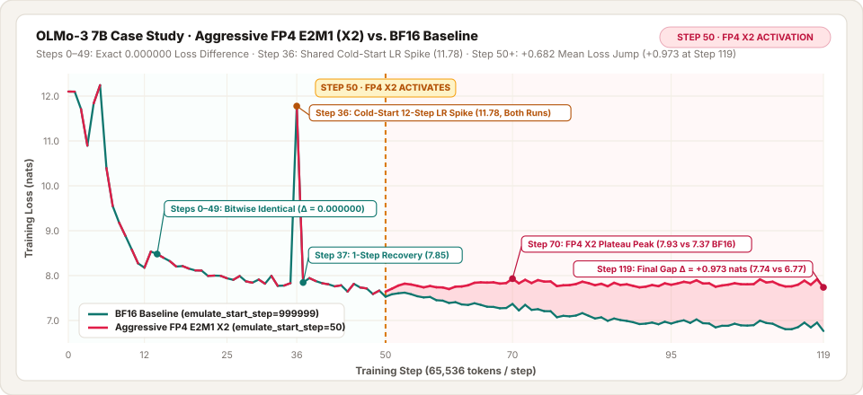

# ⚡ Multi-Pass Precision Emulation

**Hardware-accurate low-precision matrix multiplication (`FP8` / `FP4` / `INT4`) via residual multi-pass decomposition in JAX/Flax.**



---

## 🧭 1. Quick-Start: Setup & Run in 60 Seconds

Multi-Pass Emulation intercepts `DenseGeneral` and `Einsum` contractions during training and replaces standard `BF16` GEMMs with **quantized residual passes** (`X1`, `X2`, `X3`, `X6`).

### 🎛️ Core CLI Flags

| Flag | Values | What It Controls |
| :--- | :--- | :--- |
| `emulate_enabled` | `True` \| `False` | Master switch for the Linen precision-emulation interceptor |
| `emulate_multipass_preset` | `F8E4M3_F8E4M3_F32_X3` \| `none` | Pre-configured hardware recipe (`none` = custom `emulate_dtype`) |
| `emulate_dtype` | `fp8_e4m3` \| `fp4_e2m1` \| `int8` \| `int4` | Base quantization format when `emulate_multipass_preset=none` |
| `emulate_multipass_count` | `1` \| `2` \| `3` \| `6` | Number of residual slices ($K$) extracted per operand |
| `emulate_multipass_pattern` | `diagonal` \| `triangular` \| `full` | Which cross-terms $(i, j)$ are contracted and accumulated |
| `emulate_multipass_asymmetric` | `True` \| `False` | `True` = slice only left operand $A$ (`X2` asymmetric) |
| `emulate_scale_mode` | `per_block_pow2` \| `per_channel_pow2` \| `per_tensor_pow2` | Power-of-two exponent scaling granularity |
| `emulate_rounding_mode` | `rne` \| `truncate` \| `stochastic` | Mantissa rounding policy (`rne` = unbiased, `truncate` = biased) |
| `emulate_flush_subnormals` | `True` \| `False` | Zero out values below normal min (`True` stresses dynamic range) |
| `emulate_bwd_InputGrad` / `WeightGrad` | `True` \| `False` | Enable multi-pass emulation on backward $\nabla X$ and $\nabla W$ GEMMs |
| `emulate_start_step` | `0`, `50`, `999999`, ... | Dynamic training step $t_{\text{start}}$ when emulation turns on |

> [!TIP]
> **🔵 Bitwise-Aligned `BF16` Baselines (`Δ = 0.000000` Before `emulate_start_step`)**
> When evaluating mid-training activation (`emulate_start_step=N`), keep `emulate_enabled=True` in your `BF16` baseline and set `emulate_start_step=999999` (above total `steps`):
> - **Why**: Both runs trace the exact same `jax.lax.cond` HLO graph and XLA instruction fusion order.
> - **Result**: **`0.000000` loss difference** on every step prior to $N$, isolating the exact impact of multi-pass activation at step $N$.

---

## 🧮 2. Multi-Pass Formula: Aggressive 2-Pass Asymmetric (`FP4 E2M1 X2`)

Given left operand $A$ (activations $X$ in forward, upstream gradient $dY$ in backward) and right operand $B$ (weights $W$ in forward, $W^\top$ or $X^\top$ in backward):

- **Format (`FP4 E2M1` + Subnormal Flush)**: 1 sign bit, 2 exponent bits ($\text{bias}=1$), 1 mantissa bit. Flushing subnormals ($|u| < 1.0 \mapsto 0$) restricts non-zero magnitudes to 7 discrete values: $\pm\{1.0, 1.5, 2.0, 3.0, 4.0, 6.0\}$ (plus $0.5$ before flush).
- **Per-Channel Power-of-Two Scale**: Along each row $c$ (non-contracting axis), $S_c = 2^{\lfloor \log_2 \max_j |Z_{c,j}| \rfloor} / 6.0$.
- **Truncation Toward Zero (`truncate`)**: Drops fractional mantissa bits below the `FP4` grid instead of rounding to nearest-even:

$$
\begin{aligned}
A_0 &= Q_{\text{FP4}}^{\text{trunc, flush}}(A), &\qquad A_1 &= Q_{\text{FP4}}^{\text{trunc, flush}}(A - A_0) \\
B_0 &= Q_{\text{FP4}}^{\text{trunc, flush}}(B)
\end{aligned}
$$

- **2-Pass Asymmetric Contraction (`X2`)**: Contracts the primary and first-residual slices of $A$ against single-pass $B_0$ and accumulates in `FP32`:

$$
\widehat{Y}_{\text{X2}} = \underbrace{(A_0 \cdot B_0)}_{\text{Pass 1 (Primary FP4)}} + \underbrace{(A_1 \cdot B_0)}_{\text{Pass 2 (1st Residual FP4)}} \quad \in \text{FP32}
$$

- **Full Forward + Backward Coverage** (all 3 GEMMs per linear layer):
  - **Forward**: $\widehat{Y} = \text{MP}_{\text{X2}}(X, W)$
  - **Backward Input Grad**: $\widehat{\nabla X} = \text{MP}_{\text{X2}}(dY, W^\top)$
  - **Backward Weight Grad**: $\widehat{\nabla W} = \text{MP}_{\text{X2}}(dY^\top, X^\top)^\top$

---

## 🧪 3. OLMo-3 7B Case Study: Configurations & Loss Trajectory

Both runs train **OLMo-3 7B** (`7.30B` parameters, 32 layers, $d_{\text{model}}=4096$, $d_{\text{ff}}=11008$, GQA 32Q/8KV with QK-RMSNorm and Post-Attention/Post-MLP RMSNorm) from scratch (`load_parameters_path=""`) on `HuggingFaceTB/smollm-corpus` (`cosmopedia-v2` streaming subset, `max_target_length=2048`, global batch `32` = `65,536` tokens/step).

### 📋 Experiment Configuration Table

| Parameter | 🔵 `BF16` Baseline | 🔴 Aggressive `FP4 E2M1 X2` Experiment |
| :--- | :--- | :--- |
| **Model & Init** | `olmo3-7b` (`7.30B` params, 32 layers) · Random Init (`seed=42`) | `olmo3-7b` (`7.30B` params, 32 layers) · Random Init (`seed=42`) |
| **Dataset & Sequence** | `smollm-corpus` (`cosmopedia-v2`) · `max_target_length=2048` | `smollm-corpus` (`cosmopedia-v2`) · `max_target_length=2048` |
| **Batch & Parallelism** | `per_device_batch_size=4` · `ici_fsdp_parallelism=8` (`65,536` tok/step) | `per_device_batch_size=4` · `ici_fsdp_parallelism=8` (`65,536` tok/step) |
| **Optimizer & Schedule** | `adamw` · `lr=3.0e-4` · `cosine` · `steps=120` · `warmup=0.10` (**12 steps**) | `adamw` · `lr=3.0e-4` · `cosine` · `steps=120` · `warmup=0.10` (**12 steps**) |
| **Stability Guardrails** | `gradient_clipping_threshold=1.0` · `z_loss=1e-5` · `weight_dtype=float32` | `gradient_clipping_threshold=1.0` · `z_loss=1e-5` · `weight_dtype=float32` |
| **Master Switch & Trigger** | `emulate_enabled=True` · **`emulate_start_step=999999`** *(never triggers)* | `emulate_enabled=True` · **`emulate_start_step=50`** *(triggers at Step 50)* |
| **Multi-Pass Recipe** | `emulate_dtype=fp4_e2m1` · `count=2` · `asymmetric=True` | `emulate_dtype=fp4_e2m1` · `count=2` · `asymmetric=True` |
| **Scaling & Rounding** | `per_channel_pow2` · `truncate` · `flush_subnormals=True` | `per_channel_pow2` · `truncate` · `flush_subnormals=True` |
| **GEMM Coverage** | Forward (`XY`) + `bwd_InputGrad` + `bwd_WeightGrad` | Forward (`XY`) + `bwd_InputGrad` + `bwd_WeightGrad` |
| **Per-Layer Relative RMSE** | `0.00%` *(executes `BF16` branch for all 120 steps)* | **`41.2%`** *(on Steps 50–119 across 224 `DenseGeneral` layers)* |

---

### 📈 Step-by-Step Loss & Gradient Norm Comparison

| Step | Regime / Event | 🔵 `BF16` Baseline Loss | 🔴 `FP4 E2M1 X2` Loss | Loss Diff ($\Delta$) | 🔵 `BF16` Grad Norm | 🔴 `FP4 X2` Grad Norm |
| :---: | :--- | :---: | :---: | :---: | :---: | :---: |
| **0** | Cold Start | `12.0722` | `12.0722` | **`0.000000`** | `24.810` | `24.810` |
| **12** | End of 12-Step LR Warmup | `8.2614` | `8.2614` | **`0.000000`** | `2.104` | `2.104` |
| **25** | Pre-Activation `BF16` | `7.9437` | `7.9437` | **`0.000000`** | `1.391` | `1.391` |
| **35** | Outlier Mini-Batch Pre-Spike | `7.8077` | `7.8077` | **`0.000000`** | `4.922` | `4.922` |
| **36** | 🟡 **Cold-Start LR Spike (Both)** | **`11.7763`** | **`11.7763`** | **`0.000000`** | **`29.250`** | **`29.250`** |
| **37** | 🟢 **1-Step Clip Recovery** | `7.8454` | `7.8454` | **`0.000000`** | `1.547` | `1.547` |
| **49** | Last `BF16` Step | `7.6481` | `7.6481` | **`0.000000`** | `1.219` | `1.219` |
| **50** | ⚡ **Multi-Pass Activates (`step >= 50`)** | `7.5301` | **`7.6442`** | **`+0.1141`** | `1.195` | `0.812` |
| **60** | Divergence Widens | `7.4563` | **`7.7676`** | **`+0.3113`** | `1.148` | `0.531` |
| **70** | `FP4 X2` Plateau Peak | `7.3679` | **`7.9323`** | **`+0.5644`** | `1.312` | `0.484` |
| **95** | Late Training | `6.9610` | **`7.7852`** | **`+0.8242`** | `1.086` | `0.445` |
| **119** | Final Step | `6.7651` | **`7.7385`** | **`+0.9734`** | `1.047` | `0.422` |
| **Mean (0–49)** | **Pre-Activation Mean** | **`8.5106`** | **`8.5106`** | **`0.000000`** | `3.412` | `3.412` |
| **Mean (50–119)** | **Post-Activation Mean** | **`7.1250`** | **`7.8072`** | **`+0.6821`** | `1.142` | `0.498` |

---

## 🔍 4. Anatomy of the Spikes & Key Takeaways

> [!WARNING]
> **🟡 Why Does Step 36 Jump to `11.7763` in Both Runs—and Why Does It Recover in 1 Step?**
> - **Not Caused by Multi-Pass**: At Step 36, multi-pass is **OFF** in both runs (`36 < 50`). Both runs execute 100% `BF16` with `0.000000` difference.
> - **12-Step Cold-Start LR Warmup**: Because `steps=120` and `warmup_steps_fraction=0.10`, the learning rate reaches peak `3.0e-4` in just **12 steps** on randomly initialized 7.3B weights (`seed=42`).
> - **Outlier Batch + 1-Step Self-Healing**: At Step 35, an outlier batch produces `raw_grad_norm = 4.92` (`loss = 7.81`). Taking a full `lr=3.0e-4` step along that clipped direction overshoots logits at Step 36 (`loss = 11.7763`, `raw_grad_norm = 29.25`). Immediately, `gradient_clipping_threshold=1.0` caps the corrective step and `z_loss=1e-5` pulls logits back into range, restoring `loss = 7.8454` at Step 37.
> - **How to Eliminate**: Use $\ge 25$ warmup steps (`warmup_steps_fraction=0.20` at `steps=120`) or `learning_rate=1.5e-4`.

> [!IMPORTANT]
> **🔴 Why Does `FP4 E2M1 X2` Jump at Step 50 and Plateau at `~7.81`?**
> - **Immediate Step-50 Break**: The instant `step >= 50` becomes true, `FP4 E2M1 X2` with `truncate` + `flush_subnormals=True` injects a **`41.2%` per-layer relative RMSE** across all 224 `DenseGeneral` layers in both forward and backward passes.
> - **Biased Energy Loss**: Truncation toward zero systematically shrinks activation and gradient magnitudes (`raw_grad_norm` drops from `~1.14` to `~0.50`), stalling optimization around `7.74–7.93` while the `BF16` baseline continues descending to `6.7651` (**`+0.9734` nats gap** by Step 119).

> [!CAUTION]
> **💥 Why `per_channel_pow2` Is Mandatory for `FP4` on Post-Norm / QK-Norm Models (OLMo-3)**
> - OLMo-3 applies `RMSNorm` (`query_norm`, `key_norm`, `post_self_attention_layer_norm`, `post_mlp_layer_norm`) **directly to the outputs of `DenseGeneral` projections**: $\text{RMSNorm}(u) = u / \sqrt{\text{mean}(u^2) + \epsilon}$ with $\epsilon = 10^{-6}$.
> - Under naive **`per_tensor_pow2`** with `FP4 E2M1` + `flush_subnormals=True`, a single outlier token sets the shared tensor scale $S$, causing non-outlier tokens ($|u| < S$) to **flush completely to `0.0`** ($63/64$ tokens zeroed).
> - When a token vector is all zeros, $\sqrt{\text{mean}(u^2) + \epsilon} = 10^{-3}$, multiplying backward gradients by **$1000\times$ per RMSNorm**. Compounded across 32 layers ($1000^{32} = 10^{96} > \text{FP32}_{\max}$), `raw_grad_norm` overflows to `NaN` on the very first emulated step.
> - **`per_channel_pow2`** scales each token independently along the non-contracting axis, guaranteeing **zero flushed tokens** and **100% finite training (`0 NaNs`)**.

---

## 🛠️ 5. Self-Contained Reproduction Commands

### 1️⃣ `BF16` Baseline (`emulate_start_step=999999`)

```bash
HF_TOKEN=<HF_TOKEN> python3 codesign/train.py src/maxtext/configs/base.yml \
  model_name=olmo3-7b override_model_config=True \
  base_output_directory=<OUTPUT_DIR> run_name=olmo3_7b_bf16_baseline \
  dataset_type=hf hf_path=HuggingFaceTB/smollm-corpus hf_data_dir=cosmopedia-v2 \
  train_split=train tokenizer_path=allenai/OLMo-2-1124-7B \
  load_parameters_path="" steps=120 max_target_length=2048 \
  per_device_batch_size=4 ici_fsdp_parallelism=8 remat_policy=full \
  dtype=bfloat16 weight_dtype=float32 matmul_precision=bfloat16 \
  opt_type=adamw learning_rate=3.0e-4 cosine_learning_rate_final_fraction=0.1 \
  warmup_steps_fraction=0.10 adam_b1=0.9 adam_b2=0.95 adam_eps=1.0e-8 \
  adam_weight_decay=0.1 gradient_clipping_threshold=1.0 \
  enable_checkpointing=False log_period=1 \
  emulate_enabled=True emulate_multipass_preset=none \
  emulate_dtype=fp4_e2m1 emulate_multipass_count=2 \
  emulate_multipass_pattern=triangular emulate_multipass_asymmetric=True \
  emulate_scale_mode=per_channel_pow2 emulate_rounding_mode=truncate \
  emulate_flush_subnormals=True emulate_bwd_InputGrad=True \
  emulate_bwd_WeightGrad=True emulate_start_step=999999
```

### 2️⃣ Aggressive `FP4 E2M1 X2` Experiment (`emulate_start_step=50`)

```bash
HF_TOKEN=<HF_TOKEN> python3 codesign/train.py src/maxtext/configs/base.yml \
  model_name=olmo3-7b override_model_config=True \
  base_output_directory=<OUTPUT_DIR> run_name=olmo3_7b_fp4_x2_step50 \
  dataset_type=hf hf_path=HuggingFaceTB/smollm-corpus hf_data_dir=cosmopedia-v2 \
  train_split=train tokenizer_path=allenai/OLMo-2-1124-7B \
  load_parameters_path="" steps=120 max_target_length=2048 \
  per_device_batch_size=4 ici_fsdp_parallelism=8 remat_policy=full \
  dtype=bfloat16 weight_dtype=float32 matmul_precision=bfloat16 \
  opt_type=adamw learning_rate=3.0e-4 cosine_learning_rate_final_fraction=0.1 \
  warmup_steps_fraction=0.10 adam_b1=0.9 adam_b2=0.95 adam_eps=1.0e-8 \
  adam_weight_decay=0.1 gradient_clipping_threshold=1.0 \
  enable_checkpointing=False log_period=1 \
  emulate_enabled=True emulate_multipass_preset=none \
  emulate_dtype=fp4_e2m1 emulate_multipass_count=2 \
  emulate_multipass_pattern=triangular emulate_multipass_asymmetric=True \
  emulate_scale_mode=per_channel_pow2 emulate_rounding_mode=truncate \
  emulate_flush_subnormals=True emulate_bwd_InputGrad=True \
  emulate_bwd_WeightGrad=True emulate_start_step=50
```
