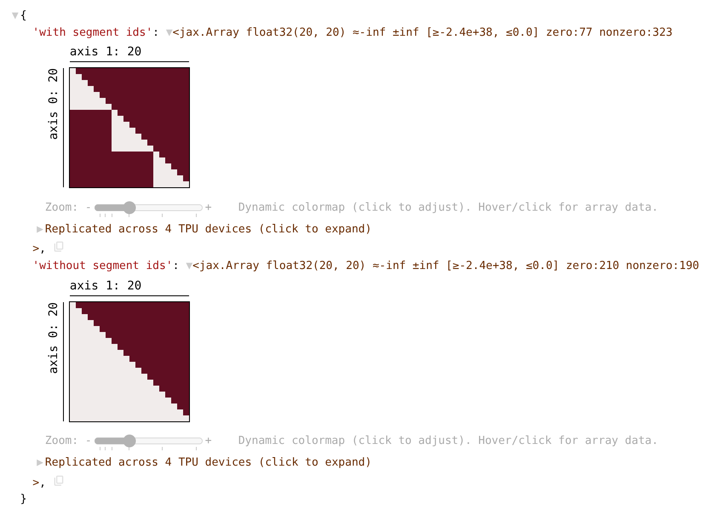

<!--
 Copyright 2026 Google LLC

 Licensed under the Apache License, Version 2.0 (the "License");
 you may not use this file except in compliance with the License.
 You may obtain a copy of the License at

      https://www.apache.org/licenses/LICENSE-2.0

 Unless required by applicable law or agreed to in writing, software
 distributed under the License is distributed on an "AS IS" BASIS,
 WITHOUT WARRANTIES OR CONDITIONS OF ANY KIND, either express or implied.
 See the License for the specific language governing permissions and
 limitations under the License.
 -->

# Treescope

[Treescope](https://github.com/google-deepmind/treescope) shows Python objects in a notebook as a tree that you can expand and collapse. Every array gets a one-line summary (shape, data type, value range, and how many entries are zero) and a heatmap you can open. This helps when an object is too big to print, such as a model's weights, and you only care about part of it. MaxText already installs Treescope. To turn it on in a notebook:

```python
import treescope

treescope.basic_interactive_setup(autovisualize_arrays=True)
```

After this, any object that a cell returns is shown this way. Outside a notebook, `treescope.render_to_html` writes the same view to an HTML file.

## Example: attention leaking across packed training examples

The [`treescope_demo.ipynb`](https://github.com/AI-Hypercomputer/maxtext/blob/main/src/maxtext/examples/treescope_demo.ipynb) notebook uses Treescope to check the attention mask on packed training examples, based on real bugs ([#4016](https://github.com/AI-Hypercomputer/maxtext/pull/4016), [#4476](https://github.com/AI-Hypercomputer/maxtext/issues/4476)), and shows what happens when segment ids are missing:


