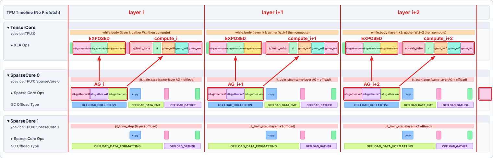
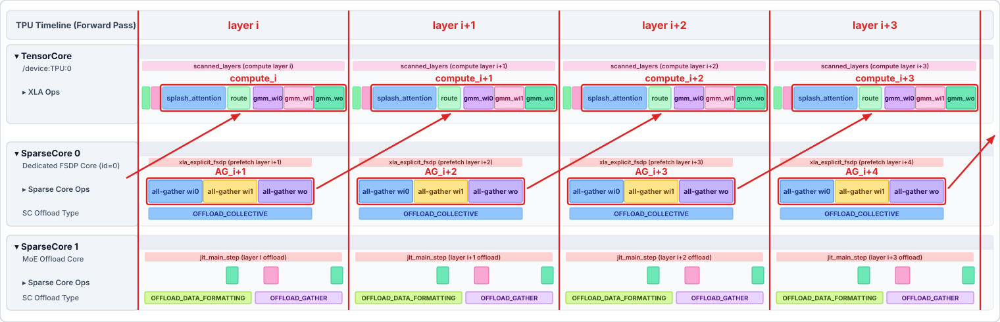
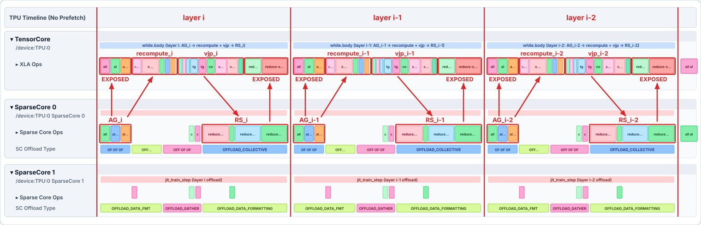
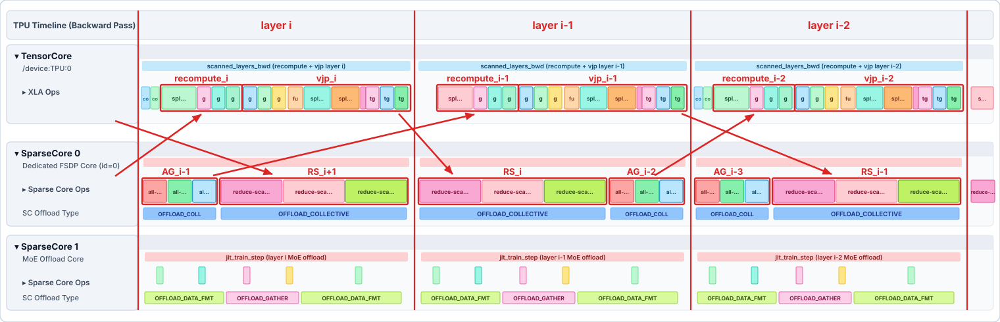

<!--
 Copyright 2026 Google LLC

 Licensed under the Apache License, Version 2.0 (the "License");
 you may not use this file except in compliance with the License.
 You may obtain a copy of the License at

      https://www.apache.org/licenses/LICENSE-2.0

 Unless required by applicable law or agreed to in writing, software
 distributed under the License is distributed on an "AS IS" BASIS,
 WITHOUT WARRANTIES OR CONDITIONS OF ANY KIND, either express or implied.
 See the License for the specific language governing permissions and
 limitations under the License.
 -->

# FSDP weight prefetching

With FSDP, every decoder layer's weights are stored sharded over the `fsdp` mesh axes (and any
co-sharded axes such as `expert` or `context`) and must be all-gathered before the layer runs, with
their weight gradients reduce-scattered after the layer's backward pass. By default XLA schedules
these collectives inside each scanned layer's `while` loop body, and depending on the model,
sharding, and remat policy they can end up exposed on the critical path.

`prefetch_fsdp_weights=True` replaces the scanned layer loop with a `jax.custom_vjp` pipeline
(`src/maxtext/layers/fsdp_prefetch.py` for homogeneous stacks and
`src/maxtext/layers/fsdp_prefetch_inhomogeneous.py` for inhomogeneous blocks) that overlaps the
collectives with compute explicitly across layers:

| Pass                                                      | Layer / sub-layer *k*                                                             |
| --------------------------------------------------------- | --------------------------------------------------------------------------------- |
| Forward                                                   | all-gather W(*k*+1) ‖ compute layer *k*                                           |
| Backward (default)                                        | all-gather W(*k*−1) ‖ (recompute + vjp of layer *k*), then reduce-scatter dW(*k*) |
| Backward (`prefetch_fsdp_defer_grad_reduce_scatter=True`) | reduce-scatter dW(*k*+1) ‖ all-gather W(*k*−1) ‖ (recompute + vjp of layer *k*)   |

### Forward pass timeline

**Without weight prefetching (`prefetch_fsdp_weights=False`):**



**With weight prefetching (`prefetch_fsdp_weights=True`):**



### Backward pass timeline

**Without weight prefetching (`prefetch_fsdp_weights=False`):**



**With weight prefetching and deferred reduce-scatter (`prefetch_fsdp_weights=True`, `prefetch_fsdp_defer_grad_reduce_scatter=True`):**



| Mechanism                                                        | What it does                                                                                                                                                                                                                                                                                 |
| ---------------------------------------------------------------- | -------------------------------------------------------------------------------------------------------------------------------------------------------------------------------------------------------------------------------------------------------------------------------------------- |
| **`unroll=2` double buffering**                                  | Both passes peel boundary layers and run `jax.lax.scan(..., unroll=2)` (`reverse=True` in backward) with an `optimization_barrier` between the two unrolled steps so consecutive layers alternate between two gathered-weight buffers without loop-carry copies.                             |
| **`all_gather(..., to="reduced")`**                              | Because weights are prefetched *outside* `jax.vjp(layer)`, `to="reduced"` tells JAX's VJP transpose to return each chip's local partial weight gradient (`unreduced`) instead of inserting an internal `all-reduce`, so the prefetch loop can issue a single SparseCore `reduce-scatter`.    |
| **`_pin_scatter_dim_major`**                                     | SparseCore hardware can only `reduce-scatter` along a tensor's outermost memory dimension. Pinning `scatter_dim` as major-most before `psum_scatter` prevents XLA from rewriting minor-dimension reductions (such as shared-expert `wo` or MLA `wkv_a`) into `all-reduce` + `dynamic-slice`. |
| **Deferred RS (`prefetch_fsdp_defer_grad_reduce_scatter=True`)** | Tags `psum_scatter` with `xla_explicit_fsdp="yes"` (running on Dedicated FSDP SparseCore 0), carries step *k*'s `unreduced` weight gradients in the backward `scan` carry, and issues their `reduce-scatter` at the **start of step *k*−1** so it overlaps step *k*−1's recompute + VJP.     |

Gathered weights are never saved between the forward and backward pass: peak live full-sized
weights/gradients in HBM are **2 layers** in forward, **3 layers** in backward by default, and
**4 layers** with `prefetch_fsdp_defer_grad_reduce_scatter=True`.

## Inhomogeneous blocks and nested scans

In composite blocks with heterogeneous sub-layers—such as **Qwen3.5** (`Qwen3NextScannableBlock`,
which scans 3 local Gated DeltaNet sub-layers followed by 1 global attention sub-layer)—prefetching
a full block at once would hold 2–3 entire blocks of gathered weights in HBM. Instead,
`src/maxtext/layers/fsdp_prefetch_inhomogeneous.py` prefetches **one sub-layer at a time** across
sub-layer and block boundaries (keeping at most **2 sub-layers** live in forward and **3–4** in
backward).

Because `jax.lax.scan` requires every iteration of an inner `while` loop to have identical input and
output `carry` PyTree structures, sub-layers can only share an inner `scan` when their incoming and
outgoing carries have the same parameter types. Boundary sub-layers whose carry crosses between
`GDN` and `Attention` are peeled into single-trip inner `while` loops (annotated with
`skip-simplify-while-loops_trip-count-one=true` so XLA does not hoist prefetches across sub-layers),
while interior sub-layers share an `unroll=2` double-buffered inner scan:

| Pass                                                        | Inner `while` loops per Qwen3.5 block            | Sub-layer                                                         | Input carry → Output carry                                                                                                                                                                                     | Why grouped or peeled                                                                                                                                                                                                 |
| ----------------------------------------------------------- | ------------------------------------------------ | ----------------------------------------------------------------- | -------------------------------------------------------------------------------------------------------------------------------------------------------------------------------------------------------------- | --------------------------------------------------------------------------------------------------------------------------------------------------------------------------------------------------------------------- |
| **Forward** (`carry = W_next`)                              | `[GDN 0, GDN 1] → [GDN 2] → [attn]` (3 loops)    | `GDN 0`<br>`GDN 1`<br>`GDN 2`<br>`attn`                           | `W(GDN 0) → W(GDN 1)`<br>`W(GDN 1) → W(GDN 2)`<br>`W(GDN 2) → W(attn)`<br>`W(attn) → W(next GDN 0)`                                                                                                            | Both are `GDN → GDN` (grouped in 1 `unroll=2` scan)<br>*(same scan as `GDN 0`)*<br>`GDN → Attn` (peeled on exit)<br>`Attn → GDN` (1-trip scan)                                                                        |
| **Backward, default** (`carry = W_prev`)                    | `[attn] → [GDN 2, GDN 1] → [GDN 0]` (3 loops)    | `attn`<br>`GDN 2, GDN 1`<br>`GDN 0`                               | `W(attn) → W(GDN 2)`<br>`W(GDN 2) → W(GDN 1) → W(GDN 0)`<br>`W(GDN 0) → W(prev attn)`                                                                                                                          | `Attn → GDN` (1-trip scan)<br>Both are `GDN → GDN` (grouped in 1 `unroll=2` scan)<br>`GDN → Attn` (peeled on exit)                                                                                                    |
| **Backward, deferred RS** (`carry = (W_prev, dW_deferred)`) | `[attn] → [GDN 2] → [GDN 1] → [GDN 0]` (4 loops) | `attn`<br>`GDN 2` (entry)<br>`GDN 1` (interior)<br>`GDN 0` (exit) | `(W(attn), dW(next GDN 0)) → (W(GDN 2), dW(attn))`<br>`(W(GDN 2), dW(attn)) → (W(GDN 1), dW(GDN 2))`<br>`(W(GDN 1), dW(GDN 2)) → (W(GDN 0), dW(GDN 1))`<br>`(W(GDN 0), dW(GDN 1)) → (W(prev attn), dW(GDN 0))` | `(Attn, GDN) → (GDN, Attn)`<br>`(GDN, Attn) → (GDN, GDN)` (peeled to flush `dW(attn)`)<br>`(GDN, GDN) → (GDN, GDN)` (4+ GDNs share `unroll=2` here)<br>`(GDN, GDN) → (Attn, GDN)` (peeled to prefetch `W(prev attn)`) |

> **Whole-block fallback (`skip_block_remat`):** Blocks that carry parameters outside their
> sub-layers (or do not define `prefetch_sublayer_names()`, such as Gemma4 or DeepSeek-V4) are
> prefetched as a whole via `fsdp_prefetch.py`, which automatically saves each sub-layer's
> `decoder_layer_input` when `skip_block_remat=True` to avoid double recomputation.

## Remat policies

`remat_policy` (including `full`, `minimal`, `save_dot_except_mlp`, and `custom` policies with
`device` or `offload` activations) applies to each decoder layer (or each sub-layer in the
inhomogeneous path). At trace time, the pipeline abstractly traces `jax.vjp` of the checkpointed
layer once per stack, classifies each residual leaf, and carries **only** the activations saved by
the policy from the forward pass to the backward pass alongside the layer inputs. The backward pass
rebuilds each layer's VJP from those saved activations and the re-gathered weights instead of
recomputing the entire layer.

With `remat_policy=full`, only each layer's input activation is saved. Gathered weights are never
saved regardless of policy: if a policy saves a residual whose shape matches a gathered weight, a
warning is logged. The number and size (in MiB) of residuals saved per layer are logged at trace
time.

## Expert and context parallelism

Under expert parallelism (`ici_expert_parallelism > 1`) or context parallelism, `fsdp_axes_for_dim`
automatically handles compound sharding axes (`('fsdp', 'expert')`, `('fsdp', 'context')`):

| Weight group                                                      | Sharding                                                                              | What FSDP prefetch gathers / reduce-scatters                                                                    |
| ----------------------------------------------------------------- | ------------------------------------------------------------------------------------- | --------------------------------------------------------------------------------------------------------------- |
| **Non-expert weights** (attention/MLA, dense MLP, shared experts) | Co-sharded across `('fsdp', 'expert')` (or `('fsdp', 'context')`)                     | Gathers **both** axes together in a single `xla_explicit_fsdp` `all-gather` (and `reduce-scatter` in backward). |
| **Routed expert weights**                                         | Partitioned across `'expert'` and sharded across `'fsdp'` (e.g. `('expert', 'fsdp')`) | Gathers **only `'fsdp'`**, so each chip keeps only its assigned experts.                                        |

- **Dedicated FSDP SparseCore 0 avoids EP contention:** EP adds heavy token dispatch/combine
  collectives (`ragged-all-to-all`) on SparseCore; isolating FSDP `all-gather` / `reduce-scatter` on
  SparseCore 0 (`--xla_tpu_explicit_fsdp_dedicated_sparse_core_id=0`) keeps them from queueing
  behind EP traffic on SparseCore 1.
- Compatible with default `EP_AS_FSDP` (`base.yml`), `custom_mesh_and_rule=ep-as-dp`, and
  `use_ring_of_experts=True`.

## Recommended flags for best performance

### Quick-start command

```bash
export LIBTPU_INIT_ARGS="\
  --xla_tpu_enable_fsdp_latency_hiding_scheduler=true \
  --xla_tpu_explicit_fsdp_dedicated_sparse_core_id=0 \
  --xla_tpu_rerun_latency_hiding_scheduler_post_sc_assignment=false"

python3 -m maxtext.trainers.pre_train.train src/maxtext/configs/base.yml \
  ... \
  scan_layers=True \
  shard_mode=explicit \
  prefetch_fsdp_weights=True \
  prefetch_fsdp_defer_grad_reduce_scatter=True \
  moe_flat_fsdp_weights=True \
  use_tokamax_gmm=True \
  use_gmm_v2=True \
  moe_gmm_v2_dlhs_transpose_rhs=True \
  moe_use_direct_token_gather=True
```

### MaxText flags

| Flag                                                         | Applies to                                            | Purpose & notes                                                                                                                                                                                                                                                         |
| ------------------------------------------------------------ | ----------------------------------------------------- | ----------------------------------------------------------------------------------------------------------------------------------------------------------------------------------------------------------------------------------------------------------------------- |
| `prefetch_fsdp_weights=True` + `scan_layers=True`            | All models                                            | Enables cross-layer FSDP weight prefetching on scanned decoder layers.                                                                                                                                                                                                  |
| `shard_mode=explicit`                                        | All models *(required for tagged FSDP & deferred RS)* | Preserves `NamedSharding` inside `custom_vjp` so gathers emit `xla_explicit_fsdp="yes"` with `to="reduced"` and gradients reduce-scatter once on SparseCore.                                                                                                            |
| `prefetch_fsdp_defer_grad_reduce_scatter=True`               | All models *(when HBM allows)*                        | Tags weight-gradient `psum_scatter`s with `xla_explicit_fsdp="yes"` and defers step *k*'s `reduce-scatter` to the start of step *k*−1 on Dedicated SparseCore 0, hiding exposed backward RS (+1 layer/sub-layer of unreduced dW in HBM).                                |
| `moe_flat_fsdp_weights=True`                                 | MoE models                                            | Stores routed-expert weights as 2D `[E * rows, cols]` sharded `P(('expert', 'fsdp'), ...)` on major dim 0, eliminating multi-GiB SparseCore `{1,0,2} ↔ {2,1,0}` relayout transposes and TensorCore copies (requires `sparse_matmul=True`, `prefuse_moe_weights=False`). |
| `moe_gmm_v2_dlhs_transpose_rhs=True`                         | MoE with Tokamax `gmm_v2`                             | Uses native `transpose_rhs` inside backward `dlhs` `gmm_v2` instead of materializing explicit 3.5 GiB RHS weight transposes on TensorCore/SparseCore.                                                                                                                   |
| `moe_use_direct_token_gather=True`                           | MoE with `use_gather_mosaic_kernel=False`             | Gathers tokens directly in expert-sorted order instead of materializing `top_k` replicated copies first.                                                                                                                                                                |
| `use_ring_of_experts=True` / `custom_mesh_and_rule=ep-as-dp` | MoE with `ici_expert_parallelism > 1`                 | Reduces EP dispatch/combine overhead (`use_ring_of_experts`) or avoids over-sharding small projections across `('fsdp', 'expert')` (`ep-as-dp`).                                                                                                                        |

### XLA flags (`LIBTPU_INIT_ARGS`)

| XLA flag                                                            | Purpose                                                                                                                                                                                                                                                                                                                 |
| ------------------------------------------------------------------- | ----------------------------------------------------------------------------------------------------------------------------------------------------------------------------------------------------------------------------------------------------------------------------------------------------------------------- |
| `--xla_tpu_enable_fsdp_latency_hiding_scheduler=true`               | Enables XLA's FSDP-aware latency-hiding scheduler, which schedules `xla_explicit_fsdp`-tagged `all-gather`s (and deferred backward `reduce-scatter`s when `prefetch_fsdp_defer_grad_reduce_scatter=True`) across the current layer's compute window.                                                                    |
| `--xla_tpu_explicit_fsdp_dedicated_sparse_core_id=0`                | Assigns `xla_explicit_fsdp`-tagged FSDP collectives (`all-gather`s, plus deferred weight-gradient `reduce-scatter`s when `prefetch_fsdp_defer_grad_reduce_scatter=True`) to a dedicated SparseCore (core 0) so they do not queue behind the layer's own SparseCore work (MoE token gathers/scatters or EP collectives). |
| `--xla_tpu_rerun_latency_hiding_scheduler_post_sc_assignment=false` | Recommended with Expert Parallelism (`ici_expert_parallelism > 1`); prevents a post-SparseCore-assignment scheduler pass from pulling `all-gather-done` ahead of the layer's MoE compute.                                                                                                                               |

## Requirements and limitations

- Only the scanned layer stack is affected: `scan_layers=True` is required.
- FSDP must be in use: when no FSDP mesh axis (`fsdp`, `fsdp_transpose`) spans more than one
  device, there is nothing to prefetch and the regular scan is used.
- `prefetch_fsdp_defer_grad_reduce_scatter=True` requires `shard_mode=explicit`.
- `save_fsdp_gathered_weights` has no effect while the prefetch path is active: the prefetch
  pipeline never saves gathered weights.
- The prefetch path is skipped (the regular scan is used) when KV caches are passed (inference),
  with forced expert routing, with `parameter_memory_host_offload=True`, or when quantization
  statistics updates are disabled.
- Non-parameter layer state is read-only in this path: state mutated inside a layer call (for
  example sown intermediates) is not propagated back.

## Results

Across homogeneous MoE models, Expert Parallelism, and inhomogeneous nested-scan blocks on 64 TPU7x
chips (4x4x4) with Tokamax `gmm_v2`:

| Model & setup                                                            | Configuration                                                                                                                                                                                               | Step time     | Speedup    | Exposed FSDP AG wait | Exposed FSDP RS wait | Peak HBM     | Workload                                                                | XProf                                                                            |
| ------------------------------------------------------------------------ | ----------------------------------------------------------------------------------------------------------------------------------------------------------------------------------------------------------- | ------------- | ---------- | -------------------- | -------------------- | ------------ | ----------------------------------------------------------------------- | -------------------------------------------------------------------------------- |
| **DeepSeek-V3 (FSDP only, 15L, 128E)** (`pdbs=2`, `seq=4096`)            | Baseline (`prefetch_fsdp_weights=False`)                                                                                                                                                                    | 2702.9 ms     | —          | 380.2 ms             | 393.0 ms             | 38.2 GiB     | [xid/302727885](https://xmanager.corp.google.com/experiments/302727885) | [trace](https://xprof.corp.google.com/trace_viewer/darisoy-4220726043009085028)  |
| **DeepSeek-V3 (FSDP only, 15L, 128E)** (`pdbs=2`, `seq=4096`)            | **Best prefetch** (`prefetch_fsdp_weights` + `moe_flat_fsdp_weights` + `prefetch_fsdp_defer_grad_reduce_scatter` + `moe_gmm_v2_dlhs_transpose_rhs` + `moe_use_direct_token_gather`)                         | **1779.0 ms** | **−34.2%** | **14.9 ms**          | **7.8 ms**           | **70.8 GiB** | [xid/305042832](https://xmanager.corp.google.com/experiments/305042832) | [trace](https://xprof.corp.google.com/trace_viewer/darisoy-9323381390778354871)  |
| **DeepSeek-V3 (`EP=4`, 15L, 256E)** (`pdbs=1`, `seq=4096`)               | Baseline (`prefetch_fsdp_weights=False`)                                                                                                                                                                    | 1916.6 ms     | —          | 302.6 ms             | 266.9 ms             | 26.5 GiB     | [xid/305535132](https://xmanager.corp.google.com/experiments/305535132) | [trace](https://xprof.corp.google.com/trace_viewer/darisoy-10305768099897910523) |
| **DeepSeek-V3 (`EP=4`, 15L, 256E)** (`pdbs=1`, `seq=4096`)               | **Best prefetch** (`prefetch_fsdp_weights` + `moe_flat_fsdp_weights` + `prefetch_fsdp_defer_grad_reduce_scatter` + `moe_gmm_v2_dlhs_transpose_rhs` + `moe_use_direct_token_gather` + `use_ring_of_experts`) | **1185.5 ms** | **−38.1%** | **26.0 ms**          | **3.2 ms**           | **45.6 GiB** | [xid/305470621](https://xmanager.corp.google.com/experiments/305470621) | [trace](https://xprof.corp.google.com/trace_viewer/darisoy-15828192385167896484) |
| **Qwen3.5-35B-A3B (nested scan, 3 GDN + 1 attn)** (`pdbs=1`, `seq=1024`) | Baseline (`prefetch_fsdp_weights=False`)                                                                                                                                                                    | 1303.2 ms     | —          | 116.1 ms             | 439.8 ms             | 7.8 GiB      | [xid/303041931](https://xmanager.corp.google.com/experiments/303041931) | [trace](https://xprof.corp.google.com/trace_viewer/darisoy-9826187937416977410)  |
| **Qwen3.5-35B-A3B (nested scan, 3 GDN + 1 attn)** (`pdbs=1`, `seq=1024`) | **Best prefetch** (`prefetch_fsdp_weights` + `moe_flat_fsdp_weights` + `prefetch_fsdp_defer_grad_reduce_scatter`)                                                                                           | **976.2 ms**  | **−25.1%** | **120.0 ms**         | **184.8 ms**         | **14.8 GiB** | [xid/304673588](https://xmanager.corp.google.com/experiments/304673588) | [trace](https://xprof.corp.google.com/trace_viewer/darisoy-6020302240827059010)  |

### DeepSeek-V3 (FSDP + `moe_flat_fsdp_weights`)

DeepSeek-V3 architecture (`deepseek3-671b`) with 15 decoder layers (3 dense + 12 MoE,
`base_num_decoder_layers=15`), 128 routed experts (`num_experts=128`), and `num_experts_per_tok=4`
on 64 TPU7x chips (4x4x4), `ici_fsdp_parallelism=-1`, `shard_mode=explicit`,
`per_device_batch_size=2`, `max_target_length=4096`, splash attention blocks 1024 forward / 2048
backward, Tokamax `gmm_v2` (`use_tokamax_gmm=True use_gmm_v2=True`), and full remat
(`remat_policy=custom` saving only `decoder_layer_input`):

| Configuration                                                                                                                                             | Step time     | Speedup    | Peak HBM     | Exposed FSDP AG wait | Exposed FSDP RS wait | Exposed SC data-format wait | TC `copy`   | XProf                                                                            |
| --------------------------------------------------------------------------------------------------------------------------------------------------------- | ------------- | ---------- | ------------ | -------------------- | -------------------- | --------------------------- | ----------- | -------------------------------------------------------------------------------- |
| Baseline, `prefetch_fsdp_weights=False` ([xid/302727885](https://xmanager.corp.google.com/experiments/302727885))                                         | 2702.9 ms     | —          | 38.2 GiB     | 380.2 ms             | 393.0 ms             | 12.3 ms                     | 276.9 ms    | [trace](https://xprof.corp.google.com/trace_viewer/darisoy-4220726043009085028)  |
| `prefetch_fsdp_weights=True`, 3D expert weights ([xid/302729431](https://xmanager.corp.google.com/experiments/302729431))                                 | 2489.4 ms     | −7.9%      | 58.5 GiB     | 18.8 ms              | 345.5 ms             | 116.5 ms                    | 313.1 ms    | [trace](https://xprof.corp.google.com/trace_viewer/darisoy-14051115723292120025) |
| `prefetch_fsdp_weights=True` + `moe_flat_fsdp_weights=True` ([xid/302730209](https://xmanager.corp.google.com/experiments/302730209))                     | 2172.4 ms     | −19.6%     | 53.2 GiB     | 19.9 ms              | 268.2 ms             | 57.0 ms                     | 150.3 ms    | [trace](https://xprof.corp.google.com/trace_viewer/darisoy-7381716295166882283)  |
| + `prefetch_fsdp_defer_grad_reduce_scatter=True` ([xid/303642733](https://xmanager.corp.google.com/experiments/303642733))                                | 1943.2 ms     | −28.1%     | 74.2 GiB     | 14.9 ms              | 1.1 ms               | 42.4 ms                     | 221.3 ms    | [trace](https://xprof.corp.google.com/trace_viewer/darisoy-8188184968343065951)  |
| **+ `moe_gmm_v2_dlhs_transpose_rhs=True` + `moe_use_direct_token_gather=True`** ([xid/305042832](https://xmanager.corp.google.com/experiments/305042832)) | **1779.0 ms** | **−34.2%** | **70.8 GiB** | **14.9 ms**          | **7.8 ms**           | **11.3 ms**                 | **88.7 ms** | [trace](https://xprof.corp.google.com/trace_viewer/darisoy-9323381390778354871)  |

With `remat_policy=custom` saving additional activations on device (`per_device_batch_size=2`,
`num_experts_per_tok=4`, 3D expert weights), prefetching stacks with the saved recompute:

| `remat_policy=custom`, saved on device                            | Baseline                                                                                                                                                            | `prefetch_fsdp_weights`                                                                                                                                            | Speedup | Peak HBM (baseline / prefetch) |
| ----------------------------------------------------------------- | ------------------------------------------------------------------------------------------------------------------------------------------------------------------- | ------------------------------------------------------------------------------------------------------------------------------------------------------------------ | ------- | ------------------------------ |
| `decoder_layer_input` only                                        | 2955 ms ([xid/299684118](https://xmanager.corp.google.com/experiments/299684118), [trace](https://xprof.corp.google.com/trace_viewer/darisoy-10753850547319992397)) | 2650 ms ([xid/299810082](https://xmanager.corp.google.com/experiments/299810082), [trace](https://xprof.corp.google.com/trace_viewer/darisoy-9862584484002790547)) | −10.3%  | 38.4 / 58.4 GiB                |
| + attention (`mla_q`, `mla_kv`, `out_proj`, `attention_out`)      | 2861 ms ([xid/299809939](https://xmanager.corp.google.com/experiments/299809939), [trace](https://xprof.corp.google.com/trace_viewer/darisoy-562152379021556752))   | 2507 ms ([xid/299809597](https://xmanager.corp.google.com/experiments/299809597), [trace](https://xprof.corp.google.com/trace_viewer/darisoy-6608057643495804677)) | −12.4%  | 46.6 / 58.8 GiB                |
| + MoE (`moe_mlpwi_0`, `moe_mlpwi_1`, `moe_mlpwo`, `moe_x_sorted`) | 2703 ms ([xid/299811090](https://xmanager.corp.google.com/experiments/299811090), [trace](https://xprof.corp.google.com/trace_viewer/darisoy-3172849855337006300))  | 2418 ms ([xid/299810085](https://xmanager.corp.google.com/experiments/299810085), [trace](https://xprof.corp.google.com/trace_viewer/darisoy-905718878884127546))  | −10.5%  | 44.2 / 66.1 GiB                |

### DeepSeek-V3 with Expert Parallelism (`ici_expert_parallelism=4`)

DeepSeek-V3 with 15 decoder layers, 256 routed experts (`num_experts=256`), `num_experts_per_tok=4`,
`ici_expert_parallelism=4`, `ici_fsdp_parallelism=-1`, `per_device_batch_size=1`,
`max_target_length=4096`, `shard_mode=explicit`, and `remat_policy=custom` on 64 TPU7x chips (4x4x4)
with the recommended XLA flags above.

With Tokamax `gmm_v2` (`use_tokamax_gmm=True use_gmm_v2=True`) and the full recommended recipe
(2D routed-expert weights, deferred backward `reduce-scatter`, `moe_gmm_v2_dlhs_transpose_rhs=True`,
`moe_use_direct_token_gather=True`, and `use_ring_of_experts=True`):

| Configuration                                                                                                                                                                                                             | Mean step time | Speedup    | Exposed FSDP AG wait | Exposed FSDP RS wait | Peak HBM     | Workload                                                                | XProf                                                                            |
| ------------------------------------------------------------------------------------------------------------------------------------------------------------------------------------------------------------------------- | -------------- | ---------- | -------------------- | -------------------- | ------------ | ----------------------------------------------------------------------- | -------------------------------------------------------------------------------- |
| Baseline (`prefetch_fsdp_weights=False`, `use_gmm_v2=True`)                                                                                                                                                               | 1916.6 ms      | —          | 302.6 ms/step        | 266.9 ms/step        | 26.5 GiB     | [xid/305535132](https://xmanager.corp.google.com/experiments/305535132) | [trace](https://xprof.corp.google.com/trace_viewer/darisoy-10305768099897910523) |
| **`prefetch_fsdp_weights=True` + `moe_flat_fsdp_weights=True` + `prefetch_fsdp_defer_grad_reduce_scatter=True` + `moe_gmm_v2_dlhs_transpose_rhs=True` + `moe_use_direct_token_gather=True` + `use_ring_of_experts=True`** | **1185.5 ms**  | **−38.1%** | **26.0 ms/step**     | **3.2 ms/step**      | **45.6 GiB** | [xid/305470621](https://xmanager.corp.google.com/experiments/305470621) | [trace](https://xprof.corp.google.com/trace_viewer/darisoy-15828192385167896484) |

Ablating the EP sharding and collective modes (`EP_AS_FSDP`, `EP_AS_DP`, and
`use_ring_of_experts=True`) with 3D routed-expert weights (`use_gmm_v2=False`):

| Configuration                                                              | Mean step time | Speedup    | Exposed FSDP AG wait | Peak HBM | Workload                                                                | XProf                                                                            |
| -------------------------------------------------------------------------- | -------------- | ---------- | -------------------- | -------- | ----------------------------------------------------------------------- | -------------------------------------------------------------------------------- |
| Baseline (`prefetch_fsdp_weights=False`)                                   | 1989.0 ms      | —          | 384 ms/step          | 23.4 GiB | [xid/301769330](https://xmanager.corp.google.com/experiments/301769330) | [trace](https://xprof.corp.google.com/trace_viewer/darisoy-4547161128859987525)  |
| `prefetch_fsdp_weights=True` (`EP_AS_FSDP`, `base.yml`)                    | 1743.0 ms      | **−12.4%** | **16 ms/step**       | 39.9 GiB | [xid/302206654](https://xmanager.corp.google.com/experiments/302206654) | [trace](https://xprof.corp.google.com/trace_viewer/darisoy-9665020563215820280)  |
| `prefetch_fsdp_weights=True` (`EP_AS_DP`, `custom_mesh_and_rule=ep-as-dp`) | 1721.7 ms      | **−13.4%** | **23 ms/step**       | 40.0 GiB | [xid/302234879](https://xmanager.corp.google.com/experiments/302234879) | [trace](https://xprof.corp.google.com/trace_viewer/darisoy-17383386889066645177) |
| `prefetch_fsdp_weights=True` + `use_ring_of_experts=True`                  | **1683.9 ms**  | **−15.3%** | **23 ms/step**       | 38.8 GiB | [xid/302288817](https://xmanager.corp.google.com/experiments/302288817) | [trace](https://xprof.corp.google.com/trace_viewer/darisoy-8791179500674840887)  |

### Qwen3.5 inhomogeneous nested scan (`qwen3_5-35b-a3b`)

Qwen3.5-35B-A3B (blocks of 3 Gated DeltaNet sub-layers + 1 global attention sub-layer) on 64 TPU7x
chips (4x4x4), `ici_fsdp_parallelism=-1`, `shard_mode=explicit`, `scan_layers=True`,
`remat_policy=custom`, `per_device_batch_size=1`, `max_target_length=1024`, and Tokamax `gmm_v2`
(`use_tokamax_gmm=True use_gmm_v2=True`):

| Configuration                                                                                  | Step time    | Speedup                                  | Peak HBM     | Workload                                                                | XProf                                                                                                                 |
| ---------------------------------------------------------------------------------------------- | ------------ | ---------------------------------------- | ------------ | ----------------------------------------------------------------------- | --------------------------------------------------------------------------------------------------------------------- |
| Baseline (`prefetch_fsdp_weights=False`)                                                       | 1303.2 ms    | —                                        | 7.8 GiB      | [xid/303041931](https://xmanager.corp.google.com/experiments/303041931) | [trace](https://xprof.corp.google.com/trace_viewer/darisoy-9826187937416977410)                                       |
| `prefetch_fsdp_weights=True` + `moe_flat_fsdp_weights=True` (2D expert weights, double buffer) | 1038.7 ms    | −20.3%                                   | 11.2 GiB     | [xid/303149411](https://xmanager.corp.google.com/experiments/303149411) | [trace](https://xprof.corp.google.com/trace_viewer/darisoy-7678417573985827042?view_start=2331.420&view_end=2351.946) |
| **+ `prefetch_fsdp_defer_grad_reduce_scatter=True`**                                           | **976.2 ms** | **−25.1%** (**−10.4%** vs. flag `False`) | **14.8 GiB** | [xid/304673588](https://xmanager.corp.google.com/experiments/304673588) | [trace](https://xprof.corp.google.com/trace_viewer/darisoy-6020302240827059010)                                       |
