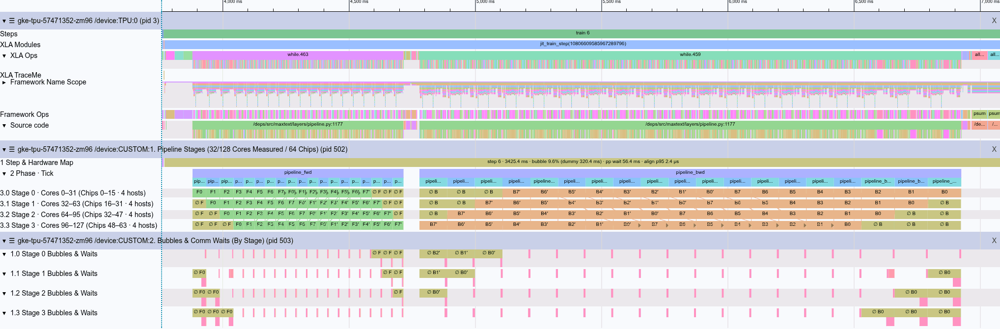
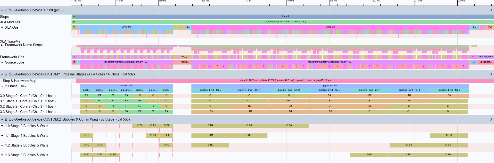

<!--
 Copyright 2026 Google LLC

 Licensed under the Apache License, Version 2.0 (the "License");
 you may not use this file except in compliance with the License.
 You may obtain a copy of the License at

      https://www.apache.org/licenses/LICENSE-2.0

 Unless required by applicable law or agreed to in writing, software
 distributed under the License is distributed on an "AS IS" BASIS,
 WITHOUT WARRANTIES OR CONDITIONS OF ANY KIND, either express or implied.
 See the License for the specific language governing permissions and
 limitations under the License.
 -->

# Pipeline Parallelism Profiling with XProf

When running MaxText with pipeline parallelism (`ici_pipeline_parallelism > 1` or `dcn_pipeline_parallelism > 1`) and `profiler=xplane`, MaxText automatically captures one representative host per pipeline stage and augments Process 0's `.xplane.pb` trace in-place so you can inspect the full multi-stage pipeline schedule directly inside [XProf](https://openxla.org/xprof).

## Quickstart

No extra flags are required beyond enabling XPlane profiling on a pipeline-parallel run:

```bash
python3 -m maxtext.trainers.pre_train.train src/maxtext/configs/base.yml \
  run_name=my_pp_run \
  base_output_directory=gs://my-bucket/outputs \
  ici_pipeline_parallelism=4 \
  num_pipeline_microbatches=8 \
  profiler=xplane \
  skip_first_n_steps_for_profiler=2 \
  profiler_steps=3
```

Open the run's profile output directory with standalone XProf:

```bash
xprof --logdir=gs://my-bucket/outputs/my_pp_run
```

Inside XProf **Trace Viewer**, Process 0's `.xplane.pb` preserves **100% of its native planes untouched** (`/device:TPU:*`, SparseCore, `/host:CPU`, `Task Environment`, `/host:metadata` HLO protos, Overview Page, Memory Viewer, and Graph Viewer) and appends two compact custom planes (`~0.2 MB` overhead):

1. **`/device:CUSTOM:1. Pipeline Stages (...)`**
   - **`1 Step & Hardware Map`**: Per-step wall time, total bubble %, SPMD lockstep dummy compute, `pp_wait`, cross-host clock alignment residual (`align_p95_us`), `ppermute` causality checks, and stage-to-core/chip/host mapping.
   - **`2 Phase · Tick`**: Loop phases and iteration/macro boundaries aligned to Process 0's native picosecond clock.
   - **`3.0 Stage 0 .. 3.{S-1} Stage {S-1}`**: Stacked per-stage timeline showing microbatch passes (`F0`, `B0`, `F0′`, `B0′`, ...), SPMD dummy compute (`∅`), and cross-stage microbatch flow arrows (`flow`).
2. **`/device:CUSTOM:2. Bubbles & Comm Waits (By Stage)`**
   - **`1.0 Stage 0 .. 1.{S-1} Stage {S-1} Bubbles & Waits`**: Per-stage SPMD dummy compute, skipped idle slots, pipeline `collective-permute` (`pp_wait`), and MoE/FSDP collective waits (`moe/fsdp`).



*Multi-host 4-stage Circular pipeline (`S=4, M=8, R=2`) in XProf Trace Viewer, showing stacked `3.0 Stage 0 .. 3.3 Stage 3` rows, cross-stage microbatch `flow` arrows, `∅` SPMD dummy compute bubbles, and per-stage `Bubbles & Waits` aligned directly below `/device:TPU:0` `XLA Ops`.*



*4-stage GPipe pipeline (`S=4, M=4, R=1`) in XProf Trace Viewer, showing forward (`F0..F3`) and backward (`B3..B0`) passes, warmup/cooldown `∅` bubbles, cross-stage `flow` connectors, and `Bubbles & Waits`.*

### Configuration Options

`enable_pipeline_stage_profiling` is the **only** new config flag added for pipeline stage profiling:

| Flag                              | Default | Description                                                                                                                                                                                                                                                                                                                                                                                                                                   |
| :-------------------------------- | :------ | :-------------------------------------------------------------------------------------------------------------------------------------------------------------------------------------------------------------------------------------------------------------------------------------------------------------------------------------------------------------------------------------------------------------------------------------------- |
| `enable_pipeline_stage_profiling` | `true`  | Automatically profiles one representative process per pipeline stage when `using_pipeline_parallelism` and `profiler=xplane`, stages non-zero stage traces under `<profile_dir>/_pp_stage_traces/process_<idx>/`, synchronizes trace flush across all processes via `multihost_utils.sync_global_devices`, and merges the decoded timeline in-place into Process 0's `.xplane.pb`. Set to `false` to restore legacy Process-0-only profiling. |
| `upload_all_profiler_results`     | `false` | Continues to profile every process when set to `true` (disabling representative-only staging while still merging stage timelines into Process 0's `.xplane.pb`).                                                                                                                                                                                                                                                                              |

When `enable_tpu_profiling_options=true`, MaxText automatically adapts `tpu_num_chips_to_profile_per_task` per process based on how many pipeline stages live on that process's local devices:

- **One stage per process** (e.g., multi-host `PP=4`): keeps `tpu_num_chips_to_profile_per_task` (`1` by default) so each stage host captures a full chip without multiplying trace size across redundant local chips.
- **Multiple stages per process** (e.g., single-process `v6e-4` with `PP=4`, or `PP=8` on 4 hosts where one process spans two stages across local chips): automatically raises `tpu_num_chips_to_profile_per_task` to trace all local chips so every local pipeline stage is covered.

### How Cross-Host Clock Alignment Works

Each profiled process writes a lightweight `pp_trace_metadata/v0` JSON sidecar mapping its local devices to mesh coordinates and pipeline stages, alongside its `.xplane.pb`. After `jax.profiler.stop_trace()` completes and all processes pass an unconditional SPMD barrier, Process 0:

1. Loads Process 0's `.xplane.pb` and the staged stage-representative traces from `_pp_stage_traces/`.
2. Aligns every remote host's timestamps onto Process 0's exact clock domain (`offset == 0` for Process 0) using global all-reduce completion anchors (typically `< 5 µs` p95 residual).
3. Decodes each stage's pipeline iterations and writes the two `/device:CUSTOM:` planes atomically into Process 0's `.xplane.pb` (idempotent if re-run).

If augmentation encounters any unexpected runtime error, MaxText logs a warning and never interrupts training.

______________________________________________________________________

## Maintaining & Extending Pipeline Trace Profiling for New Pipeline Features and Algorithms

Pipeline trace decoding lives in `src/maxtext/utils/pipeline_trace_lens.py` and relies on lightweight zero-cost `jax.named_scope` markers in `src/maxtext/layers/pipeline.py` (`pp_stage_compute`, `pp_bubble_select`, `pp_shift`).

### What Works Automatically Without Code Changes

Most model and parallelism changes work out of the box with no edits to `pipeline_trace_lens.py`:

- **New model architectures, attention variants, or MoE kernels** (dense, MoE ragged all-to-all, MegaBlox, quantized/FP8 kernels).
- **Any mesh shape, axis ordering, or topology** (single-host ring meshes, multi-host ICI/DCN meshes, varying `data`/`fsdp`/`tensor`/`expert`/`stage` sizes; device-to-stage mapping is read directly from `mesh.devices`).
- **Any valid `(S, M, R, d)` parameters**: `ici_pipeline_parallelism` / `dcn_pipeline_parallelism` (`S`), `num_pipeline_microbatches` (`M`), `num_pipeline_repeats` (`R`), `num_layers_per_pipeline_stage`, and `pipeline_delay_activation_forwarding` (`d = 1` or `2`).
- **Rematerialization and weight-gathering options**: `remat_policy`, `set_remat_policy_on_pipeline_iterations`, `pipeline_fsdp_ag_once`, and `scan_pipeline_iterations=true|false`.

### What Requires Updating `pipeline_trace_lens.py`

You should update `pipeline_trace_lens.py` whenever a pipeline change alters **which microbatch/chunk runs on each `(stage, tick)`** or **the loop structure emitted into XLA Ops**:

1. **Adding a new pipeline schedule** that changes the `(stage, tick) -> (pass, microbatch, repeat_or_chunk, valid)` mapping (for example, interleaved 1F1B, zero-bubble, or V-shaped schedules).
2. **Splitting pipeline execution into multiple phase `while` loops** without enclosing each phase in a distinct `jax.named_scope` (the built-in GPipe/Circular decoder expects 1 forward loop + 1 backward loop, or unrolled `pp_stage_compute` iterations).
3. **Peeling prologue/epilogue iterations outside `jax.lax.scan`** (the decoder needs phase/sub-tick scopes to match peeled ops back to the schedule table).
4. **Adding per-device `jax.lax.cond` skips** or changing how dummy bubble iterations execute (ensure dummy vs. useful compute still falls under the expected compute scope so `_classify_dummy_skip` classifies `dummy` vs. `skipped` accurately).

### Graceful Fallback Behavior

If `pipeline_trace_lens.py` encounters an **unregistered schedule name** or an **unexpected loop structure** (for example, a newly added algorithm or multi-loop split that has not been registered yet), it will **not crash** and will **not guess or mislabel microbatches**:

- Cross-host clock alignment still runs via global all-reduce anchors.
- Stacked `3.0 Stage 0 .. 3.{S-1}` rows are still emitted with raw `iter 0 .. T-1` tick spans.
- Plane 2 (`2. Bubbles & Comm Waits (By Stage)`) still emits measured `pp_wait` and `moe/fsdp` wait spans.
- The `1 Step & Hardware Map` row displays a `[raw iter fallback]` note with `fallback_mode=1`, `fallback_reason`, and a pointer back to this guide.

### Contributor Checklist for Adding a New Pipeline Schedule

Follow these 4 steps when introducing a new pipeline schedule or loop structure:

1. **Tag compute, communication, and phase scopes with `jax.named_scope`** in `src/maxtext/layers/pipeline.py` (or your schedule module). Keep `pp_stage_compute`, `pp_bubble_select`, and `pp_shift` for forward/backward loop schedules, or add distinct phase/sub-tick scopes (for example `phase_warmup`, `subtick_0_f`) for multi-phase schedules.
2. **Register a schedule builder via `register_pipeline_schedule(...)`** in `src/maxtext/utils/pipeline_trace_lens.py` (or in your schedule module imported at startup) returning a `PipelineSchedule` (`mode="fwd_bwd"` or `mode="phased"`).
3. **Verify sidecar metadata** in `src/maxtext/common/profiler.py` (`build_pipeline_trace_metadata`) emits your schedule name under `pipeline.schedule` and any new schedule parameters.
4. **Add a unit test** in `tests/unit/pipeline_trace_lens_test.py` verifying that `augment_host0_xplane_in_place` decodes your schedule, preserves 100% of original planes, and aligns clocks accurately.

#### Example: Registering a Custom Schedule

```python
from maxtext.utils import pipeline_trace_lens as ptl


def _build_custom_schedule(
    num_stages: int,
    num_microbatches: int,
    num_repeats: int = 1,
    forwarding_delay: int = 1,
) -> ptl.PipelineSchedule:
    n_iter = num_microbatches * num_repeats + forwarding_delay * (num_stages - 1)
    total_slots = num_microbatches * num_repeats

    def fwd_slot(iteration: int, stage: int) -> tuple[int, int, bool]:
        k = iteration - forwarding_delay * stage
        if 0 <= k < total_slots:
            return k % num_microbatches, k // num_microbatches, True
        return 0, 0, False

    return ptl.PipelineSchedule(
        name="my_custom_schedule",
        mode="fwd_bwd",
        num_stages=num_stages,
        num_microbatches=num_microbatches,
        num_repeats=num_repeats,
        forwarding_delay=forwarding_delay,
        n_iter=n_iter,
        fwd_slot=fwd_slot,
        # Optional: override bwd_slot and layer_index_fn if backward order or
        # stage traversal order differs from standard GPipe/Circular.
    )


ptl.register_pipeline_schedule("my_custom_schedule", _build_custom_schedule)
```

For multi-phase interleaved schedules with separate forward/backward/weight-gradient sub-ticks, return `PipelineSchedule(mode="phased", phases=..., pass_slot=..., scheduled_fn=..., b_mode_fn=..., phase_regex=..., subtick_regex=...)` and tag each phase loop and sub-tick with the matching `jax.named_scope` names.
