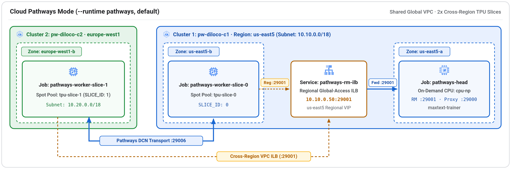
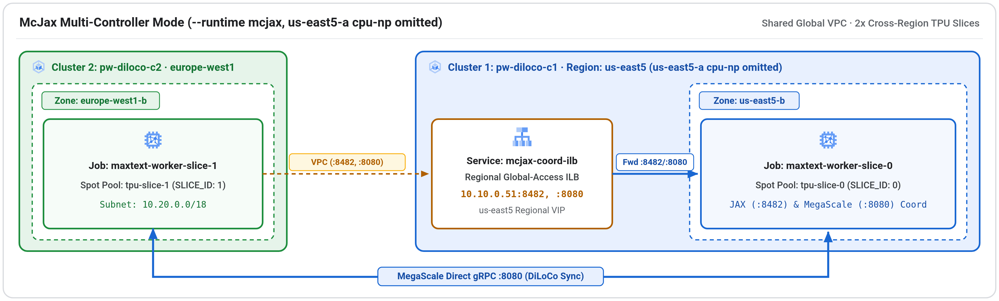

<!--
 Copyright 2026 Google LLC

 Licensed under the Apache License, Version 2.0 (the "License");
 you may not use this file except in compliance with the License.
 You may obtain a copy of the License at

    https://www.apache.org/licenses/LICENSE-2.0

 Unless required by applicable law or agreed to in writing, software
 distributed under the License is distributed on an "AS IS" BASIS,
 WITHOUT WARRANTIES OR CONDITIONS OF ANY KIND, either express or implied.
 See the License for the specific language governing permissions and
 limitations under the License.
-->

(run-cross-region-diloco)=

# Cross-region DiLoCo with Cluster Toolkit

Kubernetes `JobSet` workloads and `gcluster job submit` cannot span multiple GKE
clusters across regions. To train across regions, use `gcluster deploy` with a
multi-cluster Cluster Toolkit blueprint over a shared global VPC. Each regional
TPU slice runs inner steps over local ICI and syncs outer Streaming DiLoCo
fragments over WAN.

```{seealso}
- [DiLoCo Training Tutorial](../tutorials/diloco_pretraining.md) for
  single-cluster recipes, checkpoint resumption, and hyperparameter tuning.
- [DiLoCo Theory & Mathematics Reference](../reference/core_concepts/diloco.md)
  for inner/outer optimization equations and WAN bandwidth rooflines.
```

**Cloud Pathways mode (`--runtime pathways`, default):**



**McJax mode (`--runtime mcjax`):**



| Feature                           | Cloud Pathways (default)                                                                                                                                                                        | McJax (`--runtime mcjax`)                                                                                      |
| :-------------------------------- | :---------------------------------------------------------------------------------------------------------------------------------------------------------------------------------------------- | :------------------------------------------------------------------------------------------------------------- |
| **Blueprint group & flag**        | `workload_pathways` (`--skip workload_mcjax`)                                                                                                                                                   | `workload_mcjax` (`--skip workload_pathways`, omits `cpu-np`)                                                  |
| **Controller placement**          | Single controller (`enable_single_controller=true`) on `cpu-np` in Region 1                                                                                                                     | Multi-controller (`enable_single_controller=false`) on every TPU worker Pod                                    |
| **Cross-region ILB (`us-east5`)** | `pathways-rm-ilb` (`10.10.0.50`, TCP `29001-29002`) for Resource Manager                                                                                                                        | `mcjax-coord-ilb` (`10.10.0.51`, TCP `8080, 8482`) on Slice 0 Pod 0 for MegaScale and JAX coordinator          |
| **60-step checkpoint config**     | `enable_checkpointing=false` (inherits `base.yml` default)                                                                                                                                      | `enable_checkpointing=true`, `checkpoint_period=10000` (runs `jax.distributed.initialize()` in `max_utils.py`) |
| **Long Spot run recovery**        | Set `colocated_python_checkpointing=true`, `checkpoint_period=49`, `--sidecar_name=external`, and `colocated-python-sidecar` (see [In-memory snapshotting on GKE](run_maxtext_snapshotting.md)) | Pass `checkpoint_period=49` via `extra_maxtext_args` to restore `DiLoCoTrainState` directly from Cloud Storage |

## 1. Prerequisites

Complete the client setup in
[At scale with Cluster Toolkit (`gcluster`)](run_maxtext_via_cluster_toolkit.md):

1. **Client tools:** Install `gcluster`, `terraform`, `gcloud`, and `kubectl`
   (`gke-gcloud-auth-plugin`) on your `PATH`.
2. **TPU and CPU quota:** Check Spot TPU v5p quota in `us-east5` and
   `europe-west1`: `compute.googleapis.com/preemptible_tpu_v5p >= 8` chips and
   `tpu.googleapis.com/tpu-v5p-preemptible >= 16` TensorCores per region. Pass
   `--spot-tpu false` if you use On-Demand `compute.googleapis.com/tpu_v5p`
   quota instead. Also check On-Demand CPU quota for `N4D >= 40` vCPUs in
   `us-east5` and `N2D >= 8` vCPUs in `europe-west1`.
3. **Container image:** Push a MaxText image to
   `us-docker.pkg.dev/<PROJECT_ID>/maxtext-images/maxtext_jax_stable:latest`
   (see
   [Build and upload MaxText Docker images](../tutorials/build_maxtext.md)), or
   pass a custom URI via `--maxtext-image`.

## 2. Blueprint and training configuration

The Cluster Toolkit bundle lives under `scripts/diloco/cross_region/`:

- [deployment.yaml](https://github.com/AI-Hypercomputer/maxtext/blob/main/scripts/diloco/cross_region/deployment.yaml):
  Two-region VPC, GKE clusters, Spot TPU pools, Global-Access ILBs, and
  workload groups.
- [pathways-head.yaml.tftpl](https://github.com/AI-Hypercomputer/maxtext/blob/main/scripts/diloco/cross_region/manifests/pathways-head.yaml.tftpl)
  and
  [pathways-worker.yaml.tftpl](https://github.com/AI-Hypercomputer/maxtext/blob/main/scripts/diloco/cross_region/manifests/pathways-worker.yaml.tftpl):
  Cloud Pathways head controller (`ConfigMap` + `Job`) and Indexed TPU worker
  Job templates.
- [mcjax-worker.yaml.tftpl](https://github.com/AI-Hypercomputer/maxtext/blob/main/scripts/diloco/cross_region/manifests/mcjax-worker.yaml.tftpl):
  McJax multi-controller `ConfigMap` and Indexed TPU worker Job template.

| Deployment group            | Provisioned resources and cross-region settings                                                                                                                                                                                                                                                                            |
| :-------------------------- | :------------------------------------------------------------------------------------------------------------------------------------------------------------------------------------------------------------------------------------------------------------------------------------------------------------------------- |
| `networking`                | Global VPC with `us-east5` (`10.10.0.0/18`, Pods `10.12.0.0/14`) and `europe-west1` (`10.20.0.0/18`, Pods `10.24.0.0/14`) subnets, plus TCP rules on `29000-29006`, `8471-8482`, and `8080-8081`.                                                                                                                          |
| `cluster_r1` & `cluster_r2` | Regional GKE clusters (`c1` in `us-east5`, `c2` in `europe-west1`) with distinct `/28` control-plane CIDRs and `enable_private_ipv6_google_access: false` for routable IPv4. Each cluster adds one 2-node (`2x2x2`, 8-chip) Spot TPU v5p pool (`static_node_count: $(null)`, `NO_RESERVATION`, atomic autoscaling `0..2`). |
| `workload_pathways`         | On-Demand `cpu-np` (`n4d-standard-32` in `us-east5-a`), Global-Access ILB `pathways-rm-ilb` (`10.10.0.50`), `pathways-head`, and `pathways-worker-slice-{0,1}` Jobs (`wait_for_rollout: false`).                                                                                                                           |
| `workload_mcjax`            | Global-Access ILB `mcjax-coord-ilb` (`10.10.0.51`) and `maxtext-worker-slice-{0,1}` Jobs (`backoffLimit: 0`, `restartPolicy: Never`). Slice 0 resolves Pod `0`'s direct VPC IP to avoid ILB hairpinning.                                                                                                                   |

Cluster Toolkit stages
[qwen3_30b_streaming_diloco_cross_region.yml](https://github.com/AI-Hypercomputer/maxtext/blob/main/src/maxtext/configs/tpu/v5p/qwen3_30b_streaming_diloco_cross_region.yml)
into a Kubernetes `ConfigMap` at `/etc/maxtext-config/`. The recipe trains
**Qwen3-30B-A3B** at 8K sequence length across two 8-chip TPU v5p slices
(`~52.17 GiB` peak HBM per `95 GiB` chip):

| Config group            | Key overrides                                                                                                                                                               |
| :---------------------- | :-------------------------------------------------------------------------------------------------------------------------------------------------------------------------- |
| **Model & memory**      | `model_name=qwen3-30b-a3b`, `max_target_length=8192`, `per_device_batch_size=1`, `attention=flash`, `weight_dtype=bfloat16` (`remat_policy=full` inherited from `base.yml`) |
| **Mesh parallelism**    | `num_slices=2`, `dcn_diloco_parallelism=2`, `dcn_data_parallelism=1`, `ici_fsdp_parallelism=4`, `ici_expert_parallelism=2`                                                  |
| **Streaming DiLoCo**    | `enable_streaming_diloco=true`, `num_diloco_fragments=49`, `diloco_sync_period=49`, `diloco_outer_lr=0.7` (`1/49` of the model syncs per step)                              |
| **Uniform WAN buckets** | `diloco_bucketize_non_scanned=true` (splits 2D+ non-scanned matrices along their longest unsharded axis across fragments `1..48`)                                           |
| **Run length**          | `steps=60` (one 49-step fragment cycle plus 11 steps into cycle 2)                                                                                                          |

## 3. Automated 60-step run and teardown

Use
[run_cross_region_diloco.sh](https://github.com/AI-Hypercomputer/maxtext/blob/main/scripts/diloco/cross_region/run_cross_region_diloco.sh)
to deploy both regions, run 60 Streaming DiLoCo steps, and destroy all cloud
resources on exit:

```bash
export PROJECT_ID=<PROJECT_ID>
export GCS_BUCKET=gs://<GCS_BUCKET>

# Cloud Pathways single-controller mode (default)
./scripts/diloco/cross_region/run_cross_region_diloco.sh

# McJax multi-controller mode (omits cpu-np and pathways-rm-ilb)
./scripts/diloco/cross_region/run_cross_region_diloco.sh --runtime mcjax

# Optional XProf trace and sharding dump via --maxtext-args
./scripts/diloco/cross_region/run_cross_region_diloco.sh \
  --keep-gcs-artifacts \
  --maxtext-args "profiler=xplane skip_first_n_steps_for_profiler=46 debug_sharding=true"

# Standalone cleanup of an existing deployment
./scripts/diloco/cross_region/run_cross_region_diloco.sh \
  --project-id "${PROJECT_ID}" \
  --cleanup
```

- **Isolated state:** Generates a `<user_8chars>-<4char_sha256>-pwd` deployment
  name and writes Cluster Toolkit output under mode-`0700`
  `${XDG_STATE_HOME:-~/.local/state}/maxtext_cross_region_diloco` (`--workdir`)
  outside the repo.
- **Preflight checks:** Auto-detects the caller IPv4 (`<IP>/32`) for GKE
  `master_authorized_networks` (override via `--authorized-cidr`) and checks
  GCP APIs and cluster or VPC collisions. Pass `--enable-apis` to enable
  missing project APIs automatically.
- **Verified cleanup:** Destroys ILBs, GKE clusters, VPCs, firewall rules, NAT
  IPs, and scratch objects on exit, then runs a 10-resource leak audit. Pass
  `--force-cleanup` if you deleted the local `.deployment_ownership/` marker.

## 4. Manual deployment and monitoring

### Step 1: Deploy infrastructure and workloads

Run `gcluster deploy` from `scripts/diloco/cross_region` and skip the inactive
runtime group (`deployment.yaml` defaults `authorized_cidr` to `0.0.0.0/0`, so
pass `authorized_cidr=<YOUR_IP>/32` in `--vars` to restrict control-plane
access):

```bash
export PROJECT_ID=<PROJECT_ID>
export GCS_BUCKET=gs://<GCS_BUCKET>
cd scripts/diloco/cross_region

# Cloud Pathways (skips workload_mcjax and mcjax-coord-ilb)
gcluster deploy deployment.yaml \
  --vars "project_id=${PROJECT_ID},gcs_scratch_location=${GCS_BUCKET}" \
  --skip workload_mcjax \
  --auto-approve

# Or McJax (skips workload_pathways, cpu-np, and pathways-rm-ilb)
gcluster deploy deployment.yaml \
  --vars "project_id=${PROJECT_ID},gcs_scratch_location=${GCS_BUCKET}" \
  --skip workload_pathways \
  --auto-approve
```

### Step 2: Check TPU slice readiness

Check that both 2-node (`8`-chip) TPU v5p slices are ready:

```bash
kubectl --context="gke_${PROJECT_ID}_us-east5_pw-diloco-c1" get nodes \
  -l cloud.google.com/gke-tpu-accelerator=tpu-v5p-slice

kubectl --context="gke_${PROJECT_ID}_europe-west1_pw-diloco-c2" get nodes \
  -l cloud.google.com/gke-tpu-accelerator=tpu-v5p-slice
```

### Step 3: Stream training logs

Stream training output from Cluster 1 (`us-east5`):

```bash
# Cloud Pathways
kubectl --context="gke_${PROJECT_ID}_us-east5_pw-diloco-c1" logs -f \
  job/pathways-head -c maxtext-trainer

# McJax (Slice 0 Pod 0 coordinator)
kubectl --context="gke_${PROJECT_ID}_us-east5_pw-diloco-c1" logs -f \
  -l job-name=maxtext-worker-slice-0,batch.kubernetes.io/job-completion-index=0 \
  -c maxtext-worker
```

Training logs report per-step timing, TFLOP/s/device, and loss, while
TensorBoard records `learning/loss_island_0`, `learning/loss_island_1`, and
`learning/moe_lb_loss` under `${GCS_BUCKET}/runs`.

## 5. Clean up

If you deployed manually in Section 4, destroy all GKE clusters, TPU node pools,
load balancers, and VPC resources from `scripts/diloco/cross_region`:

```bash
gcluster destroy pw-diloco --auto-approve
```

```{tip}
If an earlier deployment stopped before clusters finished initializing (leaving
`clusters_outputs.tfvars` missing), skip both workload groups to destroy the
clusters and VPC directly:

    gcluster destroy pw-diloco --skip workload_pathways,workload_mcjax --auto-approve
```
