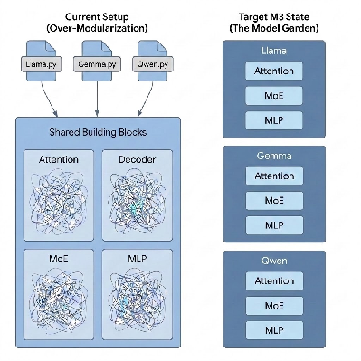
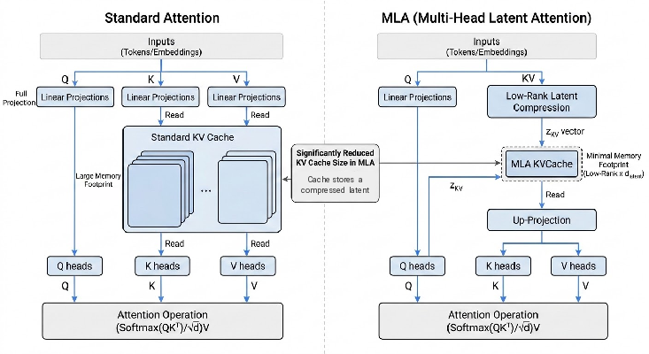

<!--
 # Copyright 2023–2026 Google LLC
#
# Licensed under the Apache License, Version 2.0 (the "License");
# you may not use this file except in compliance with the License.
# You may obtain a copy of the License at
#
#    https://www.apache.org/licenses/LICENSE-2.0
#
# Unless required by applicable law or agreed to in writing, software
# distributed under the License is distributed on an "AS IS" BASIS,
# WITHOUT WARRANTIES OR CONDITIONS OF ANY KIND, either express or implied.
# See the License for the specific language governing permissions and
# limitations under the License.
 -->

# m3: MaxText Modernization Design

> **Note:** This is the original m3 design document. The code under `src/maxtext/m3/` is the source of
> truth; file names, signatures, and layout may have evolved since this was written. See
> [`README.md`](README.md) for current conventions.

# Context

## Objective

The goal of this document is to simplify and modernize the MaxText modeling architecture. When completed, MaxText models will provide clear readability and bring-up, while continuing to provide state-of-the-art performance and scale.

Additionally, MaxText has a unique opportunity to serve as the premier "model garden" for the entire JAX ecosystem, fostering broader collaboration and adoption.

## Background

The current MaxText modeling architecture has become increasingly complex and difficult to navigate. A primary driver of this complexity is the high degree of sharing between models, which has led to the creation of parameterized "monolithic objects". This design pattern forces disparate model architectures to conform to a single, monolithic structure, resulting in code that is hard to read and even harder to extend without introducing regressions.

Additionally, feedback from both customers and partner teams has consistently highlighted this architectural complexity as a significant pain point.

To address these challenges, we are transitioning from a legacy Linen/NNX hybrid state to a pure, modular M3 (Modern MaxText Models) target state. In this new paradigm, we shift toward a "single-file per model" system—resembling a "model garden"—where each model is entirely self-contained. Under M3, models define their own full internal structures, such as attention mechanisms, which effectively eliminates the need for complex conditional logic and shared decoder dependencies.



*Simplified view. Low-level MoE dispatch and execution code is still shared across model families; see "MoE Factoring and Runtime Split" below.*

In the current AI and agentic era, where the speed of innovation is paramount, this modular setup is critical for accelerating model bring-up within MaxText. This cleanup will significantly simplify the development lifecycle and improve overall code readability. By decoupling model logic from physical hardware topology and applying infrastructure features like quantization and rematerialization as post-construction transforms, MaxText will maintain its state-of-the-art performance and scale while offering a much more maintainable developer experience.

### Cost of Inaction

**Loss of Competitive Edge:** Failing to modernize the architecture prevents MaxText from rapidly supporting emerging, high-impact architectures like DeepSeek or complex MoE variants. Forcing these into the legacy structure creates a "strategy trap" that distributes complexity rather than reducing it.

**Onboarding and Adoption Barriers:** The current scattered and intimidating nature of the codebase hinders new developer velocity, discourages customer adoption, and prevents contributions from partner teams, as the barrier to entry remains prohibitively high.

**Compounding Technical Debt:** Maintaining the status quo increases the fragility of the codebase. Simple model additions or features now risk system-wide regressions due to the impenetrable conditional logic within legacy monolithic objects.

**Researcher Stagnation:** The existing complexity acts as a "velocity tax," directly slowing down high-priority experimentation such as RL efforts and novel architecture bring-up.

# Requirements

The M3 integration balances several priorities to ensure long-term maintainability without compromising performance. The requirements are categorized as follows:

* **Performance & Extensibility (P0):** Maintain expressiveness for advanced performance features (sharding, quantization) and ensure adding new models or features is efficient and straightforward.  
* **Code Quality & Interoperability (P0.5):** Focus on clean code with minimal branching and low cyclomatic complexity. Support highly reusable components, especially for testing.  
* **Readability (P1):** Prioritize code that is easy to follow, favoring a "single-file per model" architecture that aligns with researcher preferences.  
* **Engineering Principles (P2):** Apply DRY and SOLID principles where they do not conflict with the primary goals of readability and performance isolation.

# Design

## Design Principles

1. **Pure NNX** — No Linen, no bridges. Use NNX's built-in layers (nnx.Linear, nnx.RMSNorm, nnx.Embed, etc.) directly rather than wrapping or reimplementing them.  
2. **Models own their architecture** — Each model file defines its own attention, MLP, and decoder block by composing NNX primitives. No shared "uber-attention" class parameterized for every variant. The cost of reading a 60-parameter shared Attention class dwarfs the cost of some duplication across model files.  
3. **Sharding as annotation** — A Sharding ABC maps logical axis names to mesh dimensions. Per-model subclasses define the mapping via map\_axis(). Models receive a sharding instance at construction, use it for weight metadata (kernel\_metadata) and activation constraints (sharding.constrain). Model code never references physical devices or mesh dimension names.  
4. **Config-driven** — A typed config selects model architecture and training hyperparameters. Model-specific configs are YAML files that override a base.  
5. **Use what exists** — NNX already provides Linear, Einsum, Embed (with attend()), RMSNorm, Dropout. We use these directly. We only write code that NNX doesn't provide (RoPE, training loop, sharding utilities).

## What NNX Already Provides

Flax NNX (v0.12+) has built-in layers and utilities that cover most leaf-level needs.

| Need | NNX Class | Notes |
| :---- | :---- | :---- |
| Linear projection | `nnx.Linear` | `kernel_metadata` for sharding, `dot_general` for quantization |
| Multi-axis projection | `nnx.Einsum` | e.g. `einsum_string=nta,hab->nthb'` |
| Token embedding | `nnx.Embed` | Has `attend()` for weight-tied logit projection |
| RMSNorm | `nnx.RMSNorm` | Configurable axes, dtype promotion |
| LayerNorm | `nnx.LayerNorm` | If any model needs it |
| Dropout | `nnx.Dropout` | Standard implementation |
| MHA | `nnx.MultiHeadAttention` | **No GQA, no RoPE** – not usable for model LLMS |
| Module list | `nnx.List` | **Required** for lists of child modules (plain Python lists are not tracked) |
| Optimizer | `nnx.Optimizer` | Manages parameters and optimizer state together; has `update` method. |
| Rematerialization | `nnx.remat` | Wraps a module/function for activation checkpointing |

**We do NOT wrap the layer primitives.** Model files import and use them directly.

## What We Write

Only things NNX doesn't provide:

* **RoPE** — Rotary positional embedding (base implementation; models needing YaRN, LLaMA3.1 extensions, etc. can subclass or write their own)  
* **Per-model files** — Each model (LLaMA, Gemma, etc.) defines its own attention, MLP, decoder layer, and top-level model class by composing NNX primitives  
* **Config** — Pydantic types \+ YAML loading  
* **Infrastructure utilities** — Remat module wrapper, qwix quantization helpers, host offload helpers, scan helpers (see "Scalability Infrastructure" section)  
* **Training infrastructure** — Loss functions, training step, training loop (uses built-in `nnx.Optimizer`)  
* **Sharding utilities** — Mesh creation, logical-to-mesh mapping (explicit sharding — auto-sharding is not sufficient for us). Logical-to-mesh mappings are provided by NNX, but the guidance is for users to implement explicit APIs  
* **Checkpointing** — Orbax wrapper  
* **Data loading** — Grain / HuggingFace

## Project Layout

```
m3/
    __init__.py
    core/
        rope.py              # Rotary positional embedding (pure function)
        sharding.py          # Sharding ABC, TensorType, create_mesh()
        checkpoint.py        # Orbax wrapper
        data.py              # Data loading
    infra/
        __init__.py          # Exports config/script-facing transforms: 
                             #   maybe_apply_remat, maybe_quantize, to_host
        remat.py             # Remat module wrapper + config-facing
                             #   maybe_apply_remat(model, policy)
        quantization.py      # qwix helpers and config-facing maybe_quantize()
        offload.py           # to_host plus private device/offload helpers
        scan.py              # private scan helpers until scan is config-driven
    configs/
        base.yml             # Base config with all defaults
	 config.py            # Pydantic config types + YAML loading
        ...
    models/
        __init__.py          # create_model dispatch + model registry
        llama3
            llama3.py        # LLaMA: config, attention, MLP, decoder, model
            llama3_8b.yml    # Model-specific overrides
            llama3_70b.yml   # Model-specific overrides
            llama3_405b.yml  # Model-specific overrides
            llama3_sharding.py # LlamaSharding(Sharding) rules
        deepseek
            deepseek.py      # DeepSeek: MLA, MoE, etc.
            deepseek.yml     # Model-specific overrides
            deepseek_sharding.py # DeepSeekSharding(Sharding) rules
        ...                      # Each model is self-contained
    train/
        state.py             # nnx.Optimizer creation
        step.py              # Training/eval step functions
        loop.py              # Main training loop
        loss.py              # Loss functions

```

No `layers/` directory. NNX is the layer library. Model-specific composition lives in model files. Each model has a companion `_sharding.py` file with its Sharding subclass. An `infra/` directory holds post-construction transforms (remat, quantization, host offloading, scan) applied from training setup — see "Scalability Infrastructure" section.

## Core Components

### 1\. Configuration (config.py)

Pydantic BaseModel with YAML loading. Intentionally small — add fields as architectures require them.

```py
from pydantic import BaseModel, Field
from enum import Enum
import yaml

class DType(str, Enum):
    BFLOAT16 = "bfloat16"
    FLOAT32 = "float32"

class ModelConfig(BaseModel):
    # Architecture
    model_type: str = "llama"    # selects which model file to use
    vocab_size: int = 32000
    emb_dim: int = 2048
    num_heads: int = 16
    num_kv_heads: int = 16       # < num_heads -> GQA
    num_layers: int = 24
    mlp_dim: int = 8192
    head_dim: int = 128
    rope_max_timescale: float = 10_000.0
    normalization_epsilon: float = 1e-5
    logits_via_embedding: bool = True

    # Dtypes
    dtype: DType = DType.BFLOAT16
    weight_dtype: DType = DType.FLOAT32

    # Sharding — mesh creation via ICI parallelism settings
    ici_dp_parallelism: int = 1
    ici_fsdp_parallelism: int = -1    # -1 = auto (use remaining devices)
    ici_tensor_parallelism: int = 1
    ici_expert_parallelism: int = 1

    # Training
    learning_rate: float = 3e-4
    weight_decay: float = 0.1
    warmup_steps: int = 1000
    max_steps: int = 100_000
    micro_batch_size: int = 8
    gradient_accumulation_steps: int = 1
    gradient_clip_norm: float = 1.0
    dropout_rate: float = 0.0

    # Checkpointing
    checkpoint_period: int = 1000
    checkpoint_dir: str = ""

    model_config = {"extra": "forbid"}

class TransformConfig(BaseModel):
    # Remat — "full", {"save": [...], "offload": [...]}, or None
    remat: str | dict | None = None
    quantization: Literal["int8", "fp8"] | None = None
    scan: bool = False
    host_offload_optimizer: bool = False

    model_config = {"extra": "forbid"}

class RootConfig(BaseModel):
    model: ModelConfig
    transforms: TransformConfig = Field(default_factory=TransformConfig)

    model_config = {"extra": "forbid"}

def load_config(path: str, overrides: dict | None = None) -> RootConfig:
    with open(path) as f:
        raw = yaml.safe_load(f)
    if overrides:
        raw.update(overrides)
    return RootConfig(**raw)
```

### 2\. RoPE (rope.py)

The one shared layer we write, since NNX doesn't have it. Base implementation only — models needing specialized variants (YaRN, LLaMA3.1 extended context, etc.) implement their own.

```py
import jax
import jax.numpy as jnp

def apply_rope(x: jax.Array, positions: jax.Array,
               max_timescale: float = 10_000.0) -> jax.Array:
    """Apply rotary positional embedding.

    Args:
        x: (..., head_dim) — typically (batch, seq, heads, head_dim)
        positions: integer positions, broadcastable to x[..., :1]
    """
    head_dim = x.shape[-1]
    half_dim = head_dim // 2
    freq = 1.0 / (max_timescale ** (jnp.arange(half_dim) / half_dim))
    angles = positions[..., None] * freq  # (..., half_dim)
    cos, sin = jnp.cos(angles), jnp.sin(angles)
    x1, x2 = x[..., :half_dim], x[..., half_dim:]
    return jnp.concatenate([x1 * cos - x2 * sin, x2 * cos + x1 * sin], axis=-1)
```

### 3\. A Model File (models/llama.py)

Each model file is self-contained: it defines attention, MLP, decoder layer, and the top-level model by composing NNX built-in layers \+ `apply_rope`. Here's LLaMA as the reference implementation:

```py
from jax.ad_checkpoint import checkpoint_name
from flax import nnx
import jax
import jax.numpy as jnp
from m3.config import ModelConfig
from m3.rope import apply_rope

class Attention(nnx.Module):
    def __init__(self, config: ModelConfig, *, rngs: nnx.Rngs, sharding):
        self.num_heads = config.num_heads
        self.num_kv_heads = config.num_kv_heads
        self.head_dim = config.head_dim
        self.rope_max_timescale = config.rope_max_timescale
        self.sharding = sharding

        s = sharding
        kw = dict(use_bias=False, rngs=rngs)

        self.q_proj = nnx.Einsum((config.emb_dim, config.num_heads, config.head_dim), "...e,ehd->...hd", kernel_metadata={"sharding": s("q_proj", ("embed", "heads", "head_dim"))}, **kw)
        self.k_proj = nnx.Einsum((config.emb_dim, config.num_kv_heads, config.head_dim), "...e,ehd->...hd", kernel_metadata={"sharding": s("k_proj", ("embed", "kv_heads", "head_dim"))}, **kw)
        self.v_proj = nnx.Einsum((config.emb_dim, config.num_kv_heads, config.head_dim), "...e,ehd->...hd", kernel_metadata={"sharding": s("v_proj", ("embed", "kv_heads", "head_dim"))}, **kw)
        self.o_proj = nnx.Einsum((config.num_heads, config.head_dim, config.emb_dim), "...hd,hde->...e", kernel_metadata={"sharding": s("o_proj", ("heads", "head_dim", "embed"))}, **kw)

    def __call__(self, x, positions, mask=None):
        s = self.sharding
        q = self.q_proj(x)
        q = apply_rope(q, positions, self.rope_max_timescale)
        q = checkpoint_name(q, 'query_proj')
        q = s.constrain(q, "query", ("batch", "length", "heads", "head_dim"))

        k = self.k_proj(x)
        k = apply_rope(k, positions, self.rope_max_timescale)
        k = checkpoint_name(k, 'key_proj')
        k = s.constrain(k, "key", ("batch", "length", "kv_heads", "head_dim"))

        v = self.v_proj(x)
        v = checkpoint_name(v, 'value_proj')
        v = s.constrain(v, "value", ("batch", "length", "kv_heads", "head_dim"))

        # checkpoint before GQA repeat so we save num_kv_heads, not num_heads
        if self.num_kv_heads < self.num_heads:
            reps = self.num_heads // self.num_kv_heads
            k = jnp.repeat(k, reps, axis=2)
            v = jnp.repeat(v, reps, axis=2)

        q, k, v = (jnp.transpose(t, (0, 2, 1, 3)) for t in (q, k, v))
        scale = self.head_dim ** -0.5
        attn = jnp.matmul(q, k.transpose(0, 1, 3, 2)) * scale
        if mask is not None:
            attn = jnp.where(mask, attn, jnp.finfo(attn.dtype).min)
        attn = jax.nn.softmax(attn.astype(jnp.float32)).astype(q.dtype)
        attn = checkpoint_name(attn, 'attn_weights')

        out = jnp.matmul(attn, v)
        out = checkpoint_name(out, 'attention_out')
        out = jnp.transpose(out, (0, 2, 1, 3))
        out = s.constrain(out, "attn_out", ("batch", "length", "heads", "head_dim"))
        return self.o_proj(out)

class MLP(nnx.Module):
    def __init__(self, config: ModelConfig, *, rngs: nnx.Rngs, sharding):
        self.sharding = sharding
        s = sharding
        kw = dict(use_bias=False, rngs=rngs)
        self.gate = nnx.Linear(config.emb_dim, config.mlp_dim, kernel_metadata={"sharding": s("gate", ("embed", "mlp"))}, **kw)
        self.up = nnx.Linear(config.emb_dim, config.mlp_dim, kernel_metadata={"sharding": s("up", ("embed", "mlp"))}, **kw)
        self.down = nnx.Linear(config.mlp_dim, config.emb_dim, kernel_metadata={"sharding": s("down", ("mlp", "embed"))}, **kw)

    def __call__(self, x):
        x = jax.nn.silu(self.gate(x)) * self.up(x)
        x = checkpoint_name(x, 'mlpwi')
        x = self.sharding.constrain(x, "mlp_mid", ("batch", "length", "mlp"))
        return self.down(x)

class DecoderLayer(nnx.Module):
    def __init__(self, config: ModelConfig, *, rngs: nnx.Rngs, sharding):
        self.sharding = sharding
        self.attn_norm = nnx.RMSNorm(config.emb_dim, epsilon=config.norm_eps, rngs=rngs)
        self.attn = Attention(config, rngs=rngs, sharding=sharding)
        self.mlp_norm = nnx.RMSNorm(config.emb_dim, epsilon=config.norm_eps, rngs=rngs)
        self.mlp = MLP(config, rngs=rngs, sharding=sharding)

    def __call__(self, x, positions, mask=None):
        s = self.sharding
        x = x + self.attn(self.attn_norm(x), positions, mask)
        x = s.constrain(x, "post_attn", ("batch", "length", "embed"))
        x = x + self.mlp(self.mlp_norm(x))
        x = s.constrain(x, "post_mlp", ("batch", "length", "embed"))
        return x

class Llama(nnx.Module):
    def __init__(self, config: ModelConfig, *, rngs: nnx.Rngs, sharding):
        self.embed = nnx.Embed(config.vocab_size, config.emb_dim, rngs=rngs)
        self.layers = nnx.List([DecoderLayer(config, rngs=rngs, sharding=sharding) for _ in range(config.num_layers)])
        self.norm = nnx.RMSNorm(config.emb_dim, epsilon=config.norm_eps, rngs=rngs)

    def __call__(self, tokens, positions, mask=None):
        x = self.embed(tokens)
        for layer in self.layers:
            x = layer(x, positions, mask)
        x = self.norm(x)
        return self.embed.attend(x)
```

#### Key Observations

* \~120 lines for the complete model, fully readable top to bottom  
* sharding is constructor-injected — the model uses logical axis names, never physical mesh dimensions  
* `checkpoint_name` annotations are zero-cost no-ops outside remat — they tag activations for the remat policy  
* `sharding.constrain` calls are lightweight activation sharding constraints  
* No `maybe_remat`, no `dot_general`, no conditional infrastructure — remat and quantization applied post-construction  
* Uses `nnx.Linear`, `nnx.Einsum`, `nnx.Embed`, `nnx.RMSNorm` directly — no wrappers  
* `nnx.List` for the layer collection (required for NNX graph tracking)  
* `apply_rope` and sharding are the only imports from m3's own code (besides config)  
* A Gemma model file would look similar but with its own differences (post-attention norm, logit soft-capping, alternating local/global attention) — written explicitly, not parameterized

### 4\. Model Dispatch

```py
# models/__init__.py
_MODELS = {
    "llama": (Llama, LlamaSharding),
    "deepseek": (DeepSeek, DeepSeekSharding),
}

def create_model(config: ModelConfig, *, rngs):
    model_cls, sharding_cls = _MODELS[config.model_type]
    return model_cls(config, rngs=rngs, sharding=sharding_cls())
```

This is the only dispatch point. Each model family registers its model class and sharding rules; all families consume the same config object and read only the fields they own. Not a monolithic Decoder.

### 5\. Sharding (sharding.py)

Sharding is built around a Sharding ABC that maps logical axis names to mesh dimension names. Each model family subclasses it with pattern-matching rules. Models receive a Sharding instance at construction and use it for both weight metadata and activation constraints.

```py
class TensorType(Enum):
    Weight = "weight"
    Activation = "activation"

class Sharding(ABC):
    @abstractmethod
    def map_axis(self, axis, tensor_name, tensor_type):
        """Map one logical axis to mesh axis name(s), or None for unconstrained."""
        ...

    def __call__(self, tensor_name, axes, tensor_type=TensorType.Weight):
        return P(*(
            None if a is None else self.map_axis(a, tensor_name, tensor_type)
            for a in axes
        ))

    def constrain(self, x, tensor_name, axes):
        return jax.lax.with_sharding_constraint(
            x, self(tensor_name, axes, TensorType.Activation)
        )

```

Per-model sharding rules use pattern matching on (axis, tensor\_type):

```py
# llama_sharding.py
class LlamaSharding(Sharding):
    def map_axis(self, axis, tensor_name, tensor_type):
        match axis, tensor_type:
            case "batch", TT.Activation: return ("dp", "fsdp")
            case "embed", TT.Weight: return "fsdp"
            case "embed", TT.Activation: return None
            case ("heads" | "kv_heads"), _: return "tp"
            case "head_dim", _: return None
            case "mlp", _: return "tp"
            case "vocab", _: return "tp"
            case _: return None
```

The TensorType enum allows different mappings per type — e.g. "embed" maps to "fsdp" for weights (FSDP sharding) but None for activations (unconstrained).

**Constructor injection** — models receive a sharding instance and use it at construction for weight metadata and in \_\_call\_\_ for activation constraints:

```py
class Attention(nnx.Module):
    def __init__(self, config, *, rngs, sharding):
        s = sharding
        self.q_proj = nnx.Einsum((config.emb_dim, config.num_heads, config.head_dim), "...e,ehd->...hd", kernel_metadata={"sharding": s("q_proj", ("embed", "heads", "head_dim"))}, use_bias=False, rngs=rngs)
        ...

    def __call__(self, x, positions, mask=None):
        q = self.q_proj(x)
        q = apply_rope(q, positions, self.rope_max_timescale)
        q = self.sharding.constrain(q, "query", ("batch", "length", "heads", "head_dim"))
        ...
```

The sharding callable resolves logical axes to a PartitionSpec at construction time. When a mesh is active (jax.sharding.set\_mesh), Flax handles eager placement of parameters onto the mesh based on kernel\_metadata.

**Mesh creation** uses ICI parallelism settings with auto-fill:

```py
def create_mesh(cfg=None, **overrides):
    """Create mesh from ici_dp_parallelism, ici_fsdp_parallelism (-1 = auto),
    ici_tensor_parallelism, ici_expert_parallelism."""
    ...
    return Mesh(np.array(devices).reshape(shape), ("dp", "fsdp", "tp", "ep"))
```

At most one axis can be \-1 (meaning "use all remaining devices"). The mesh is activated as a context manager in the training setup:

```py
mesh = create_mesh(cfg)
with jax.sharding.set_mesh(mesh):
    model = Llama(config, rngs=rngs, sharding=LlamaSharding())
    ...
```

On a single device, create\_mesh(ici\_fsdp\_parallelism=1, ici\_tensor\_parallelism=1) produces a trivial mesh — all PartitionSpecs resolve to replicated, so the code path is identical.

### 6\. Training (train/)

Uses the mutable `nnx.Optimizer` pattern. This keeps state as a collection of managed objects—clean for JIT and standard NNX workflows. While the functional approach with `nnx.TrainState` is possible, the mutable pattern is the primary recommendation for pure NNX training loops.

#### State (train/state.py)

```py
def create_optimizer(config, model):
    """Create Optimizer from model using NNX's built-in."""
    tx = optax.adamw(config.learning_rate, config.weight_decay)
    return nnx.Optimizer(model, tx)

```

`nnx.Optimizer` manages the model parameters and the optimizer state together. It provides an update method that applies gradients directly to the model parameters it tracks.

#### Loss (train/loss.py)

```py
def cross_entropy_loss(logits, targets, mask=None):
    log_probs = jax.nn.log_softmax(logits.astype(jnp.float32))
    loss = -jnp.sum(jax.nn.one_hot(targets, logits.shape[-1]) * log_probs, axis=-1)
    if mask is not None:
        return jnp.sum(loss * mask) / jnp.maximum(jnp.sum(mask), 1.0)
    return jnp.mean(loss)
```

#### Step (train/step.py)

```py
def train_step(model, optimizer, batch):
    def loss_fn(model):
        logits = model(batch["tokens"], batch["positions"], batch["mask"])
        return cross_entropy_loss(logits, batch["targets"], batch["target_mask"])

    loss, grads = nnx.value_and_grad(loss_fn)(model)
    optimizer.update(grads)
    return {"loss": loss}
```

#### Loop (train/loop.py)

```py
def train(cfg):
    mesh = create_mesh(cfg)
    with jax.sharding.set_mesh(mesh):
        model = create_model(cfg["model"]["type"], cfg["model"], rngs=nnx.Rngs(cfg["seed"]))
        transform_cfg = cfg["transforms"]

        # Infrastructure composition order: remat → quantize → Optimizer → host offload
        maybe_apply_remat(model, transform_cfg["remat"])
        model = maybe_quantize(model, transform_cfg["quantization"], *sample_inputs)
        optimizer = nnx.Optimizer(model, optax.adamw(cfg.learning_rate))
        if transform_cfg["host_offload_optimizer"]:
            optimizer.opt_state = to_host(optimizer.opt_state)

        for step in range(cfg["max_steps"]):
            batch = next(data_iter)
            metrics = train_step(model, optimizer, batch)
            if step % cfg["checkpoint_period"] == 0:
                save_checkpoint(nnx.split(model, optimizer)[1], cfg["checkpoint_dir"], step)
```

## Scalability Infrastructure

### The Problem

In MaxText, scalability concerns (remat, sharding, quantization, host offloading, pipeline parallelism) are scattered throughout model code: 35+ sharding calls in forward passes, model-mode-dependent axis name selection in every layer, quantization branching in \_\_init\_\_ and \_\_call\_\_, conditional device\_put in hot paths. This makes model code unreadable and tightly couples architecture to infrastructure.

### Our Approach: Lightweight Annotations in Model Code, Heavy Infrastructure Applied Externally

Model code contains only lightweight, zero-cost annotations: sharding calls for weight/activation placement and checkpoint\_name for remat activation tagging. Everything else — remat wrapping, quantization, host offloading, scan — is applied post-construction via transforms. This approach was validated in an early proof of concept and again during integration.

#### Two levels of visibility:

1. Model files (`llama.py`) — Architecture \+ sharding annotations. Sharding is visible because it's a property of each tensor (weight metadata and activation constraints). The annotations are lightweight (`s("q_proj", ("embed", "heads", "head_dim")`) for weights, `s.constrain(x, "query", (...))` for activations) and are zero-cost on a single device. checkpoint\_name calls for remat activation tagging are similarly zero-cost annotations. No `maybe_remat`, no `dot_general`, no conditional infrastructure.  
2. Training setup — Infrastructure transforms applied after model construction. Remat, quantization, host offloading, scan. All explicit under the config's transforms block and composed in one place.

The training setup is the single site where infrastructure decisions beyond sharding are composed:

```py
mesh = create_mesh(cfg)
with jax.sharding.set_mesh(mesh):
    model = Llama(config, rngs=rngs, sharding=LlamaSharding())
    maybe_apply_remat(model, policy)                                # wrap layers when configured
    model = maybe_quantize(model, quantization, *sample_inputs)     # qwix

    optimizer = nnx.Optimizer(model, optax.adamw(cfg.learning_rate))
    optimizer.opt_state = to_host(optimizer.opt_state)              # host offload

```

### Model Kernels (Attention and GLU)

Rather than maintaining model-mode branching for attention and GLU, M3 abstracts these under a thin kernel adapter layer in `kernels.py`. It exposes a unified API `dot_product_attention` and `gated_linear_unit` supporting a variety of kernels such as `legacy` (default JAX/XLA path and `cudnn` on GPU), `tokamax`, `splash`, and `auto` (pre-defined defaults for TPU, GPU, CPU).

```py
def dot_product_attention(
    query: jax.Array,
    key: jax.Array,
    value: jax.Array,
    *,
    bias: jax.Array | None = None,
    mask: jax.Array | None = None,
    is_causal: bool = False,
    backend: KernelBackend = "legacy",
    implementation: KernelImplementation = None,
) -> jax.Array:
    # Normalize inputs to drop sharding on broadcast dimensions of size 1
    query = cast(jax.Array, _normalize_broadcast_sharding(query))
    key = cast(jax.Array, _normalize_broadcast_sharding(key))
    value = cast(jax.Array, _normalize_broadcast_sharding(value))
    bias = cast(jax.Array | None, _normalize_broadcast_sharding(bias))
    mask = cast(jax.Array | None, _normalize_broadcast_sharding(mask))

    if _use_tokamax(backend):
        tokamax = _import_tokamax(required=True)
        return cast(
            jax.Array,
            tokamax.dot_product_attention(
                ...
            ),
        )

    if backend == "splash" or implementation == "splash":
        from jax.experimental.pallas.ops.tpu.splash_attention import splash_attention_kernel
        from jax.experimental.pallas.ops.tpu.splash_attention import splash_attention_mask

        def _splash_impl(q, k, v):
            ...
            return jnp.transpose(...)

        sharding_q = _named_sharding_of(query)
        mesh = getattr(sharding_q, "mesh", None) or jax.sharding.get_abstract_mesh()

        if mesh is not None and sharding_q is not None:
            ...

        wrapped = jax.sharding.auto_axes(_splash_impl, out_sharding=_sharding_of(query) or jax.P(None))
        return cast(jax.Array, wrapped(query, key, value))

    return cast(
        jax.Array,
        jax.nn.dot_product_attention(
            query, key, value,
            bias=bias, mask=mask,
            is_causal=is_causal,
            implementation=_legacy_attention_implementation(implementation),
        ),
    )

```

## Per-Concern Design

### Rematerialization

Applied post-construction via maybe\_apply\_remat(model, policy) in infra/transforms.py. Model files contain checkpoint\_name() annotations for activation tagging (zero-cost no-ops outside remat) but never import or call remat directly.

**Why a module wrapper:** nnx.remat(module) returns a plain Python function, not an NNX module. Storing that function in a list makes the wrapped module's parameters invisible to nnx.split/nnx.merge — a silent correctness bug where layer parameters are frozen during training. The Remat wrapper preserves NNX graph tracking by keeping the inner module as a child attribute.

> **Note:** The current m3 code does not have this shared remat wrapper. Models that support remat apply `jax.checkpoint` inside their own forward pass.

**Policy API** — the policy argument to `maybe_apply_remat` supports three forms:

* `"full"` — recompute everything (no activations saved)  
* `{"save": [...], "offload": [...]}` — per-activation strategy using checkpoint\_name tags from model code. save keeps activations on device; offload moves them to host memory during the backward pass. Either key can be omitted.  
* `callable` — a raw JAX checkpoint policy function

```py
# infra/transforms.py
def _apply_remat(model, policy="full"):
    remat_policy = _resolve_policy(policy)
    for i in range(len(model.layers)):
        model.layers[i] = _make_remat(model.layers[i], remat_policy)

def maybe_apply_remat(model, policy=None):
    if policy is not None:
        _apply_remat(model, policy)

def _resolve_policy(policy):
    match policy:
        case "full": return None
        case {"save": save, "offload": offload}:
            return checkpoint_policies.save_and_offload_only_these_names(
                names_which_can_be_saved=save, names_which_can_be_offloaded=offload,
                offload_src="device", offload_dst="pinned_host")
        case {"save": save}:
            return checkpoint_policies.save_only_these_names(*save)
        case _ if callable(policy): return policy
```

Model code tags activations with checkpoint\_name — these are zero-cost no-ops outside remat, but become the hooks that the policy uses to decide what to save/offload:

```py
# In model __call__
q = checkpoint_name(q, 'query_proj')
k = checkpoint_name(k, 'key_proj')
```

**Key property:** \_apply\_remat is model-agnostic. It handles heterogeneous layer types (e.g. DeepSeek's mixed `DenseDecoderLayer`/`MLADecoderLayer`) without knowing their types.

**Tradeoff:** The wrapper adds a module segment to parameter paths (`layers.0.module.attn.q_proj.kernel` vs `layers.0.attn.q_proj.kernel`). This is consistent within a given remat config. Checkpoint loading across configs can use Orbax path remapping if needed.

### Quantization

Quantization uses [qwix](https://github.com/google/qwix), which replaces our earlier plan of manual dot\_general injection. qwix.quantize\_model() traces the model, finds all dot\_general ops, and replaces them according to quantization rules — no manual tree walking needed.

```py
# infra/quantization.py
def _quantize_model(model, rules, *sample_inputs, **sample_kwargs):
    return qwix.quantize_model(model, _ExplicitQtProvider(rules), *sample_inputs, **sample_kwargs)

def _int8_rules(module_path=".*layers.*"):
    return [qwix.QtRule(module_path=module_path, weight_qtype=jnp.int8, act_qtype=jnp.int8, bwd_qtype=jnp.int8, op_names=("dot_general",))]

def _fp8_rules(module_path=".*layers.*"):
    return [qwix.QtRule(module_path=module_path, weight_qtype=jnp.float8_e4m3fn, act_qtype=jnp.float8_e4m3fn, bwd_qtype=jnp.float8_e5m2, op_names=("dot_general",))]

def maybe_quantize(model, quantization, *sample_inputs, **sample_kwargs):
    match quantization:
        case "int8": return _quantize_model(model, _int8_rules(), *sample_inputs, **sample_kwargs)
        case "fp8": return _quantize_model(model, _fp8_rules(), *sample_inputs, **sample_kwargs)
        case _: return model
```

Applied in training setup after remat, before Optimizer creation. Requires sample inputs for tracing:

```py
maybe_apply_remat(model, policy)
model = maybe_quantize(model, "int8", tokens, positions, mask=mask)
```

Key properties:

* Selective quantization via `module_path` regex (e.g. `.*attn.*`, `.*experts.*`)  
* Composes with Remat wrapper (apply remat first, then qwix)  
* NNX module paths are /-separated: `layers/0/attn/q_proj` (with Remat: `layers/0/module/attn/q_proj`)  
* `nnx.Embed.attend()` uses `jnp.dot` directly and is not quantizable by qwix

### Parameter Sharding

Handled via `kernel_metadata={"sharding": sharding("proj_name", logical_axes)}` on every layer at construction time. The `sharding` callable (a `Sharding` subclass instance) resolves logical axes to a `PartitionSpec` — the model never sees physical mesh dimension names. When a mesh is active, Flax places parameters eagerly based on the resolved PartitionSpec.

### Activation Sharding

Activation constraints use the same `Sharding` instance, called via `sharding.constrain(x, tensor_name, logical_axes)` in `__call__`. This wraps `jax.lax.with_sharding_constraint` and resolves logical axes through the same `map_axis` dispatch (with `TensorType.Activation` instead of `TensorType.Weight`).

The constraints are lightweight — each is a single method call that reads like documentation of the tensor's shape semantics:

```py
q = self.sharding.constrain(q, "query", ("batch", "length", "heads", "head_dim"))
x = self.sharding.constrain(x, "post_attn", ("batch", "length", "embed"))
```

This avoids MaxText's 35+ `maybe_shard()` calls by making sharding a property of the tensor rather than a conditional infrastructure call.

### Host Offloading

Two mechanisms, both applied in training setup (the model never knows where its parameters live):

**Param/optimizer offloading** — moves pytree leaves to `"pinned_host"` memory. On TPU/GPU, JIT handles device transfers automatically; on CPU, explicit round-trips are needed.

```py
# infra/offload.py
def to_host(tree):
    shardings = jax.tree.map(lambda x: x.sharding.with_memory_kind("pinned_host"), tree)
    return jax.device_put(tree, shardings)
```

Applied after Optimizer creation:

```py
state = state.replace(opt_state=to_host(state.opt_state))
```

**Activation offloading** — handled via the remat policy (see Rematerialization above). checkpoint\_name tags in model code mark activations; the {"offload": \["query\_proj", "key\_proj"\]} policy offloads them to host during the backward pass.

#### Scanned Layers

Optional optimization that stacks homogeneous layers for O(1) compilation. Training setup applies it through maybe\_apply\_scan(model, scan):

```py
# infra/scan.py
transforms.maybe_apply_scan(model, transform_cfg.scan)
```

```py
transforms:
  scan:
    enabled: true
```

```py
def _scan_forward(x, blocks, positions, mask):
    def forward(carry, layer_state):
        layer = nnx.merge(blocks.graphdef, layer_state)
        return layer(carry, positions, mask), None
    return jax.lax.scan(forward, x, blocks.state)[0]
```

Composes with remat by applying remat before scan, then stacking the wrapped layer states. It also composes with qwix because quantization runs after scan against the transformed model. For heterogeneous models (e.g. DeepSeek with dense \+ MoE layers), `maybe_apply_scan` scans each homogeneous run separately. Qwen3 MoE is deliberately rejected for now because its decoder layers return router-logit side outputs for auxiliary loss, which needs a separate scanned-output contract.

### Pipeline Parallelism

A layer-stacking concern. The model defines layers; the training infrastructure decides whether to stack them sequentially, scan them, or pipeline them. This decision lives in training setup, not in the model.

### Checkpoint Conversion & Hugging Face Integration

To streamline the loading and saving of checkpoints and address the complexity of traditional on-disk checkpoint converters, MaxText is adopting a dynamic, in-memory conversion strategy. This approach enables the loading and stacking of Hugging Face safetensors directly into native MaxText sharded formats within host and accelerator memory during initialization, eliminating intermediate serialization overhead and avoiding out-of-memory (OOM) compilation issues on large topologies.

## Infrastructure Composition Order

```py
construct model → maybe_apply_remat → maybe_apply_scan → maybe_quantize → split → Optimizer → host offload
```

Each step is a one-liner in training setup. The model is pure architecture \+ sharding annotations at construction; everything else is layered on after using the `nnx.Optimizer` to manage state transitions.

## Summary: Where Each Concern Lives

| Concern | Where Visible | How Applied |
| :---- | :---- | :---- |
| Remat | `transforms.remat` \+ training setup | `maybe_apply_remat(model, policy)` post-construction transform |
| Quantization | `transforms.quantization` \+ training setup | `maybe_quantize(model, quantization, …)` post-construction (after remat) |
| Param sharding | Model constructor | `kernel_metadata{“sharding”: sharding(“name”, axes)}` via injected `Sharding` instance |
| Activation sharding | Model `__call__` | `sharding.constrain(x, “name”, axes)` via injected `Sharding` instance |
| Host offloading | `transforms.host_offload_optimizer` \+ training setup | `to_host(optimizer.opt_state)` after `Optimizer` creation |
| Scanned layers | `transforms.scan` \+ training setup | `maybe_apply_scan(model, transform_cfg["scan"])` |
| Pipeline parallelism | Training setup | Layer stacking strategy |

## Design Rationale: Why No Shared Layer Library

MaxText has layers/attentions.py (1177 lines, 60+ constructor params), layers/linears.py (572 lines with model-specific norm selection), and layers/decoders.py (1093 lines with a monolithic-object Decoder). This complexity comes from trying to make every layer handle every model variant through parameterization.

Our stance: **the cost of a shared uber-layer is higher than the cost of some duplication.** Specifically:

1. **NNX already is the layer library.** `nnx.Linear`, `nnx.RMSNorm`, `nnx.Embed` cover the truly universal leaf-level operations. We don't wrap them.  
2. **Attention varies too much between models.** LLaMA has GQA \+ RoPE. Gemma2 has alternating local/global attention \+ logit soft-capping \+ post-attention norm. Qwen3 has gated attention output. DeepSeek has MLA. Trying to parameterize all of this in one class produces MaxText's 60-parameter Attention.\_\_init\_\_ and an \_\_call\_\_ full of model-name checks.  
3. **MLP varies too.** SwiGLU vs GeGLU vs MoE, optional pre-norm inside MLP, fused gate/up projections — enough variation that a shared MlpBlock accumulates flags and branches.  
4. **Readability wins.** A 100-line `llama.py` that you can read top-to-bottom beats tracing through `models.py` \-\> `Decoder.__call__` \-\> `get_decoder_layers()` \-\> `llama2.py` \-\> back to `Decoder` for layer stacking.  
5. **When two models share an implementation, one imports from the other.** No need for a pre-built universal component. If Mistral attention is identical to LLaMA attention, `mistral.py` can import `Attention` from `llama.py`.

### Decision Making for Shared Modules

While the M3 architecture prioritizes a "single-file per model" approach to maximize readability and isolation, shared modules are strategically utilized for performance-critical or excessively complex logic, such as Mixture of Experts (MoE) components. This ensures that sophisticated runtime logic remains maintainable without cluttering individual model definitions. Furthermore, if other components or patterns become excessively repetitive across multiple model families over time, the team may choose to provide a standardized shared module to balance deduplication with architectural clarity.

### MoE Factoring and Runtime Split

M3 scales to multiple sparse model families (e.g. DeepSeek V3 and Qwen3 MoE) using a strict separation of concerns:

1. **Shared Low-Level Runtime**  
   1. Dropless and capped dispatch planning  
   2. Packing tokens in to expert batches  
   3. Expert-parallel grouping and execution backends: `dense`, `ragged_dot`, and `megablox`  
   4. Low-level grouped matmul kernel selection  
2. **Model-Specific Files**  
   1. **DeepSeek V3:** Owns grouped routing, optional router bias, sigmoid activation on routing scores, capped counting planning, share experts, and split gate/up/down expert weights  
   2. **Qwen3 MoE:** Owns softmax routing, top-k normalization, auxiliary load-balancing loss, and packed `gate_up` \+ `down` expert weights

This layout prevents the shared MoE block from turning into a complex config tangle full of model-name branching.

DeepSeek MoE call:

```py
router_logits, pre_bias_logits = self.router(x)
weights, indices = select_topk(
    router_logits, pre_bias_logits,
    top_k=self.top_k, num_experts=self.num_experts,
    routed_score_func=self.routed_score_func,
    routed_scaling_factor=self.routed_scaling_factor,
    norm_topk_prob=self.norm_topk_prob,
    n_routing_groups=self.n_routing_groups,
    topk_routing_group=self.topk_routing_group,
)

shared_out = jnp.zeros_like(x, out_sharding=self.sharding.act_spec("shared_expert_out", ("batch", "norm_length", "embed")))
for expert in self.shared_experts:
    shared_out = shared_out + expert(x)

routed_out = execute_routed_moe(
    x, weights, indices,
    self.experts.gate[...],
    self.experts.up[...],
    self.experts.down[...],
    runtime_config=self.runtime_config,
    num_experts=self.num_experts,
    combine_sharding=self.sharding.act_spec("combine_weights", ("batch", "length", "experts")),
    hidden_sharding=self.sharding.act_spec("expert_mlpwi", ("batch", "length", "experts", "expert_mlp")),
    outputs_sharding=self.sharding.act_spec("all_expert_out", ("batch", "length", "experts", "embed")),
    out_sharding=self.sharding.act_spec("routed_out", ("batch", "norm_length", "embed")),
        )

return shared_out + routed_out
```

Qwen3 MoE call:

```py
router_logits, weights, indices = self.router(x)
gate, up = jnp.split(self.experts.gate_up[...], 2, axis=-1)
routed_out = execute_routed_moe(
    x, weights, indices,
    gate, up,
    self.experts.down[...],
    runtime_config=self.runtime_config,
    num_experts=self.experts.gate_up.shape[0],
    combine_sharding=self.sharding.act_spec("combine_weights", ("batch", "length", "experts")),
    hidden_sharding=self.sharding.act_spec("expert_mlpwi", ("batch", "length", "experts", "expert_mlp")),
    outputs_sharding=self.sharding.act_spec("all_expert_out", ("batch", "length", "experts", "embed")),
    out_sharding=self.sharding.act_spec("routed_out", ("batch", "norm_length", "embed")),
)
return routed_out, router_logits

```

## What We Skip (for now)

* **Linen compatibility** — Pure NNX only  
* **Pipeline parallelism** — Design exists (layer stacking in training setup), implement when needed  
* **KV cache / inference** — Training-first; when added, separate model variants rather than model\_mode branching  
* **Custom attention kernels** — Use JAX default, swap in Flash/Pallas later

## Key Differences from MaxText

| Aspect | MaxText | m3 |
| :---- | :---- | :---- |
| Module system | Hybrid Linen \+ NNX with bridge wrappers | Pure NNX |
| Leaf layers | Custom wrappers (`DenseGeneral`, custom `RMSNorm`, etc.) | Use `nnx.Linear`, `nnx.RMSNorm`, `nnx.Embed` directly |
| Shared attention | 1177-line class, 60 params, handles all models | None — each model owns its attention |
| Model organization | Central `Decoder` monolithic-object dispatches to model-specific layers | Per-model files, each self-contained |
| Infrastructure in model code | 35+ sharding calls, `model_mode` branching, quantization conditionals in forward passes | `__call__` has lightweight sharding constraints and checkpoint\_name annotations; no conditionals, no `dot_general` injection, no remat calls |
| Remat | `checkpoint_name` scattered through layers \+ 105-line policy method in `Decoder` | `Remat` module wrapper at layer stacking site |
| Config | 2600-line Pydantic \+ OmegaConf \+ env vars | Slim Pydantic \+ YAML |

# Alternatives Considered

The following modular attention framework was considered as an alternative approach to managing complexity within the modeling architecture.

### Attention Implementation Modules

Based on an analysis of how attention is currently implemented and parameterized in MaxText, we would need 5 distinct modules to split every separate Attention architecture into its own self-contained module. This reduces configuration complexity and allows each model class to import only the specific attention layer it needs.

A key motivation for this architectural split is to standardize the interfaces between the attention logic and external infrastructure. By moving to self-contained modules, we avoid the need to reimplement common logic—such as the specific pathways for calling through to the KVCache for vLLM integration—within every model definition. This allows for a unified infrastructure integration layer while allowing the internal attention structures to vary significantly.

However, this modular attention approach was not chosen because it is likely to lead back to the same heavily configured and modular system that the M3 modernization aims to move away from. The amount of reimplementation required for the selected single-file approach is not extensive and follows a common pattern observed in other successful model repositories. This design is ultimately more beneficial when small, model-specific modifications are needed for slightly different implementations, as it preserves clarity and prevents the accumulation of complex shared dependencies.

**The 5 Separate Attention Modules**

* **StandardAttention (GQA / MHA Attention)**  
  * **Target Models:** LLaMA 2/3, Mistral, Mixtral, Gemma/Gemma 2/Gemma 3, GPT-3, OLMo.  
  * **Purpose:** Standard Multi-Head (MHA) or Grouped-Query Attention (GQA).  
  * **Key Characteristics:** Standard linear projections; standard text-based position embeddings or RoPE variations; traditional KVCache structure.  
  * **Configurations eliminated:** Low-rank parameters, visual RoPEs, query splitting/gating, donor/shared KV threading.  
* **MLAAttention (Multi-Head Latent Attention)**  
  * **Target Models:** DeepSeek V3 / V3.2.  
  * **Purpose:** Compressed latent attention to optimize KV cache storage.  
  * **Key Characteristics:** Low-rank latent compression of queries and KV states; specialized MlaKVCache; integrated sparse attention Indexer module with KL-divergence loss.  
  * **Configurations eliminated:** Standard KV projection layers, non-latent standard KVCache instances, and vanilla RMSNorms.



* **SharedKVAttention (Cross-Layer KV-Sharing Attention)**  
  * **Target Models:** Gemma 4 Small.  
  * **Purpose:** Sharing computed key/value activations across adjacent layers.  
  * **Key Characteristics:** Supports donor layers (computing/scaling KV) and shared layers (skipping projections/norms to consume shared KV).  
  * **Configurations eliminated:** Conditional checks and branching logic (share\_kv\_layer, compute\_shared\_kv) inside standard GQA graphs.  
* **Qwen3GatedAttention (Gated Hybrid Attention)**  
  * **Target Models:** Qwen3, Qwen3-Next, Qwen3.5.  
  * **Purpose:** Gated hybrid attention structure with specific head-splitting and activation modulation.  
  * **Key Characteristics:** Splits queries into query and gate paths; applies sigmoid gating to modulate output; utilizes Qwen3NextRMSNorm and PartialRotaryEmbedding.  
  * **Configurations eliminated:** Query splitting/gating mechanisms and Qwen3-specific normalizations.  
* **VisionAttention (Multimodal Attention)**  
  * **Target Models:** Gemma 4 Vision, LLaMA Vision, Qwen3 Omni/Thinker.  
  * **Purpose:** Vision-transformer (ViT) patch-based attention.  
  * **Key Characteristics:** Custom multi-dimensional vision-specific rotary embeddings; custom dimensional layouts and spatial merges.  
  * **Configurations eliminated:** Text-specific RoPE configurations and standard causal/padding masks.

**Why Paged, Local/Sliding, and Flash Attention remain unified**

Configurations for attention kernels (e.g., dot\_product, flash, paged) are runtime execution parameters handled dynamically by backend operators. Since these choices do not alter the parameter weights or structural projections initialized in Flax modules, they do not require separate weight-bearing modules.

### Shared Linear Blocks vs. Single-File Duplication

The approach of using shared linear blocks for MLPs across models was considered but ultimately rejected. While a simple MLP block (like the one shown in the PoC below) appears straightforward, production-scale requirements introduce significant complexity.

```py
class MLP(nnx.Module):

  def __init__(self, config: LlamaConfig, *, rngs: nnx.Rngs):
    kw = dict(use_bias=False, rngs=rngs)
    self.gate = nnx.Linear(config.emb_dim, config.mlp_dim, **kw)
    self.up = nnx.Linear(config.emb_dim, config.mlp_dim, **kw)
    self.down = nnx.Linear(config.mlp_dim, config.emb_dim, **kw)

  def __call__(self, x):
    return self.down(jax.nn.silu(self.gate(x)) * self.up(x))
```

```py
self.mlp = linears.GatedMlpBlock(
    in_features=config.emb_dim,
    intermediate_dim=config.mlp_dim,
    activation="silu",
    use_bias=False,
    ...
)
```

This approach was not selected due to the high degree of small, model-specific variance between MLP implementations. Architectures differ significantly in their use of SwiGLU vs. GeGLU vs. MoE, as well as variations in internal pre-norms and fused projections. Forcing these disparate requirements into a shared block would inevitably lead back to the same over-parameterization and complex branching logic that the M3 modernization aims to eliminate. This decision is consistent with our broader rationale for avoiding a shared layer library: prioritizing readability and isolation over the risks of a monolithic, shared dependency.

### Modular Auto-Generation

Modular auto-generation is considered a potential long-term roadmap feature that leverages reusable pieces to auto-generate the single-file-per-model structure. While this mirrors the philosophy of [modular transformers](https://transformers-community-transformers-tenets.hf.space/#-modular-transformers), it is not currently prioritized due to bandwidth constraints. We can reevaluate providing this option at a future time.

# Implementation Order

1. **Config** — `config.py`, `configs/base.yml`  
2. **RoPE** — `rope.py`  
3. **First model** — `models/llama.py` (LLaMA as reference architecture)  
4. **Sharding** — `sharding.py`  
5. **Training** — `train/state.py`, `train/loss.py`, `train/step.py`, `train/loop.py`  
6. **Data** — `data.py`  
7. **Checkpoint** — `checkpoint.py`  
8. **More models** — `models/gemma.py`, etc. as needed

# Complexity Analysis

## Complexipy Metrics

[complexipy](https://pypi.org/project/complexipy) was used to evaluate the cognitive complexity of the existing MaxText architecture vs. the m3 proposal. The following highlights confirm m3 will provide a massive cognitive complexity improvement:

| Family | m3 Path | m3 funcs | m3 Total | m3 Peak | MaxText Path | MaxText funcs | MaxText Total | MaxText Peak | Total Ratio |
| :---- | :---- | :---- | :---- | :---- | :---- | :---- | :---- | :---- | :---- |
| Llama | 1 file | 13 | 5 | 2 | 5 files | 49 | 248 | 54 | 49.6x |
| DeepSeek | 2 files | 41 | 17 | 4 | 6 files | 76 | 399 | 57 | 23.5x |
| Qwen3 MoE | 2 files | 40 | 19 | 6 | 6 files | 85 | 400 | 57 | 21.1x |

## General Metrics

| Family | m3 files | m3 non-comment LOC | m3 config fields | MaxText files | MaxText non-comment LOC | MaxText key shared API surface |
| :---- | :---- | :---- | :---- | :---- | :---- | :---- |
| LLaMA | 1 | 212 | 14 | 5 | 2187 | `Attention.__init__` \= 40 args, `Transformer.__call__` \= 12 args |
| DeepSeek | 2 | 1165 | 34 | 6 | 3483 | `MLA.__init__` \= 64 args, `Decoder.__call__` \= 10 args |
| Qwen3 MoE | 2 | 988 | 27 | 6 | 3509 | `Attention.__init__` \= 40 args, `Decoder.__call__` \= 10 args |

## Glossary

* **Path:** The number of files constituting the model architecture.  
* **funcs:** The number of functions within the model's implementation.  
* **Total:** The total cyclomatic complexity score of the codebase.  
* **Peak:** The highest cyclomatic complexity score of a single function.  
* **Total Ratio:** The ratio of cognitive complexity between the legacy MaxText architecture and the M3 proposal.  
* **non-comment LOC:** The total lines of code, excluding comments, representing the actual implementation size.  
* **key shared API surface:** The complexity of the public-facing API for the model components, measured by the number of arguments in major classes like Attention or Decoder.
