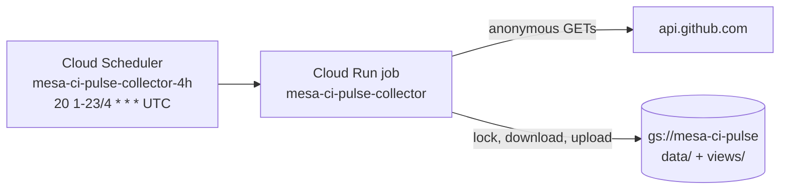

# CI Pulse collector on Cloud Run (PoC)

This folder runs the collector in `../collector/` as a Cloud Run job every 4 hours (01:20, 05:20, ...
UTC, soon after each of MaxText's 4-hourly scheduled CI runs finishes). The store and the
views live in a private GCS bucket instead of a branch. It is a proof of concept: it reads GitHub
**without a token**, to show that the pipeline works before a GitHub App is requested.

## What one execution does (`job.py`)

1. **Lock.** Creates `.lock` in the bucket, but only if it does not exist yet (`ifGenerationMatch=0`).
   A lock older than 30 minutes belongs to an execution that died, and is taken over. If another
   execution holds the lock, this one exits 75 and touches nothing.
2. **Download.** Copies every store and view file (`data/`, `views/`) to a temporary directory.
   Each copy is checked against the MD5 the bucket lists.
3. **Tick.** Runs `python -m collector.tick --out <tmp>/store` with `CI_PULSE_TICK_ARGS`. The tick
   is stopped after 10 minutes.
4. **Upload.** Uploads only the files that changed, in this order: rows, `state.json`, month views,
   and `meta.json` **last**. Every write has a generation precondition, so a file that changed
   in the bucket meanwhile is never overwritten. Files the tick pruned are deleted after
   `meta.json`. It refuses to delete more than half of the stored files (and more than 20), because
   that would be a lost store, not pruning.
5. **Unlock**, then one JSON log line with everything worth knowing, including the tick's own
   budget readings (`tick_budget`), why it stopped early (`tick_stopped_early`) and any problem it
   reported (`tick_problems`). With no token the budget belongs to an IP address, and on Cloud Run
   two connections can leave from different addresses, so only the tick's readings describe the
   budget it actually spent.

It uploads after exit 0 (ok), exit 1 (some data lost: the next tick re-reads it) and a timeout,
because every store file is written whole. It does not upload after exit 2 (bad arguments) or
a crash.

| Exit | Meaning |
| --- | --- |
| 0 | The tick finished and the bucket is up to date. |
| 1 | The tick lost some data. What it did collect was saved, and the next tick tries again. |
| 2 | Bad settings or bad tick arguments. Nothing was saved. |
| 3 | The bucket could not be read or written, or the lock was lost. |
| 4 | The tick ran past `CI_PULSE_TICK_TIMEOUT_SECONDS`. What it wrote was saved. |
| 5 | The tick was killed by a signal (out of memory, for example). Nothing was saved. |
| 75 | Another execution holds the lock. |

## Settings (environment variables)

| Variable | Default | Meaning |
| --- | --- | --- |
| `CI_PULSE_BUCKET` | (required) | The bucket that holds the store |
| `CI_PULSE_PREFIX` | empty | A folder in the bucket, ending in `/` |
| `CI_PULSE_TICK_ARGS` | empty | Extra `collector.tick` arguments. `--out`, `--repo` and `--dry-run` are refused. |
| `CI_PULSE_REPO` | `AI-Hypercomputer/maxtext` | The repository to read |
| `CI_PULSE_TICK_TIMEOUT_SECONDS` | 600 | When the tick is stopped |
| `CI_PULSE_LOCK_STALE_SECONDS` | 1800 | When a lock counts as left behind |
| `CI_PULSE_NO_UPLOAD` | unset | `1`: run the tick on a copy and upload nothing (for checks) |
| `GITHUB_TOKEN` | unset | Passed to the tick. Unset in the PoC; an App token goes here later. |

The PoC runs the tick with `--skip-tests --rate-floor 15 --max-wait 30 --merge-checks list
--defer-running --backfill-days 3` (see the tick options in `../collector/README.md`).

## Files

| File | What it is |
| --- | --- |
| `job.py` | The entry point (`python -m cloudrun.job`) |
| `Dockerfile` | `python:3.12-slim` pinned by digest, hashed dependencies, non-root user |
| `requirements.in` / `requirements.txt` | The two direct dependencies, and the full pinned and hashed set |
| `deploy.sh` | `infra`, `image`, `job`, `schedule`, `alerts`, `run`, `status`, `teardown` |
| `alerts.sh` | The email channel and the two alert policies |
| `tests/job_test.py` | Offline tests: a bucket held in memory with real generation rules |
| `tests/gcs_live_test.py` | The GCS adapter against a real bucket (`CI_PULSE_LIVE_BUCKET=...`) |

## Running the tests

    # From tools/ci_metrics:
    python3 -B cloudrun/tests/job_test.py
    CI_PULSE_LIVE_BUCKET=mesa-ci-pulse python3 -B cloudrun/tests/gcs_live_test.py   # needs google-cloud-storage

## What a token would change

Set `GITHUB_TOKEN` (an App installation token) and remove `--skip-tests`, `--rate-floor 15`,
`--max-wait 30`, `--merge-checks list` and `--defer-running` from `CI_PULSE_TICK_ARGS`. Nothing
else changes.

## Known limits

- **Memory grows with the store.** Every execution downloads the whole store into `/tmp`, which
  Cloud Run keeps in memory. Since 2026-10-21 the store holds the full history (runs from Aug 26,
  about 550 MB), and rebuilding one month's views takes up to about 1.2 GB more (measured:
  October 845 MB, September 1,190 MB). So the job has 8 GiB and 2 vCPUs (`deploy.sh job`; Cloud
  Run jobs allow at most 4 GiB with 1 vCPU). The store levels off at about 1 GB, because the tick
  deletes the months that leave the 90-day window. To use less, download only the months the tick
  reads (the open months' rows and every month's views).
- **No token, no tests.** Test counts, failed test names and flaky tests need artifact downloads,
  which GitHub refuses without a token (401).
- **60 requests an hour per IP address.** One execution collects about 25 runs. Two connections
  from Cloud Run can leave from different addresses, so each execution may get a fresh 60.
